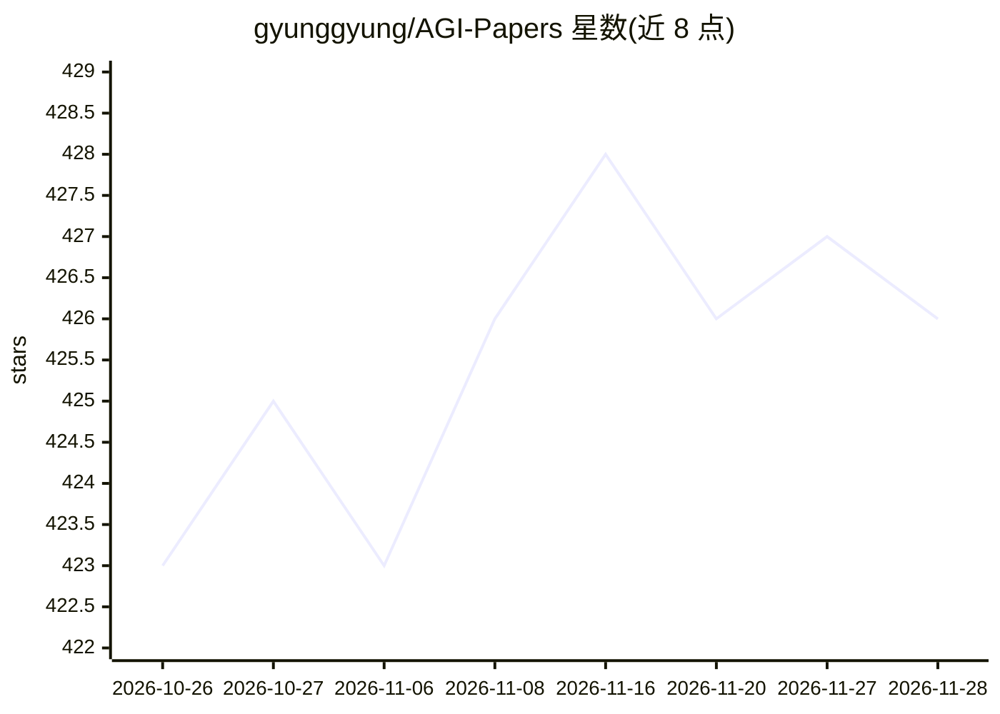

# gyunggyung/AGI-Papers

⭐ 426 · MIT · 推送 2026-11-06 · [GitHub](https://github.com/gyunggyung/AGI-Papers) · [官网](https://www.linkedin.com/in/kiwoong-yeom/) · 个人维护

**面向 AI 研究者与学习者的 AGI 方向论文/评论归档清单**

以韩文撰写的论文评论归档仓库，按 Agents、Architecture、Pre-Training、Post-Training、推理与提示、评估、RAG、On-Device AI 等 10+ 主题分类整理论文条目，每条附摘要式评述；内容源自作者 LinkedIn 的深度评论，另设草稿区与历史归档链接。仓库本体为知识整理，不含可运行代码，条目覆盖前沿模型架构分析与框架评论。

## 筛选速览

| 维度 | 判定 | 备注 |
|---|---|---|
| AI 角色 | `ai-knowledge` | 知识聚合/清单类 |
| 许可风险 | `permissive` | MIT |
| 部署形态 | `None` |  |
| 模型依赖 | — | README 未给出锁定关系 |
| 硬件要求 | — | 无带数字的原话,不猜 |
| 安装摩擦 | `low` | 无编译、无系统依赖或容器化 |
| 成熟度 | — | 结构信号不足 |

## 能力要点

- 按 10+ 主题分类的论文评论归档（Agents/架构/训练/RAG 等）
- 每条附韩文摘要式评述，源自作者 LinkedIn 深度内容
- 含 Pre-release 洞见与写作中草稿区、历史归档链接

## 适用场景

- 按主题查找前沿论文与其摘要评述
- 了解 Agents、模型架构、RAG 等方向的最新研究脉络
- 韩语学习者跟踪 LLM 研究动态

## 场景标签

`精选清单` · 领域:学习与行业

## 证据(README 行号)

> L8: > A curated archive of breakthroughs in **Agents**, **Architecture**, **Training**, **RAG**, and **On-Device AI**.
> L18: 이 저장소는 **AGI(Artificial General Intelligence)** 로 향하는 여정에서 중요한 논문들을 리뷰하고 아카이빙하는 공간입니다.
> L34: 이 저장소는 AGI를 향한 여정을 다음 10가지 핵심 주제로 분류하여 정리합니다.

## 星数曲线

2026-10-26 423 → 2026-11-28 426（+3）

---
*卡片 v1 · prompt 1.4 · 生成 2026-11-25 · 置信度 high · 依据 README sha `949dde24e3f3` · [字段定义](../../DATASET.md)*
