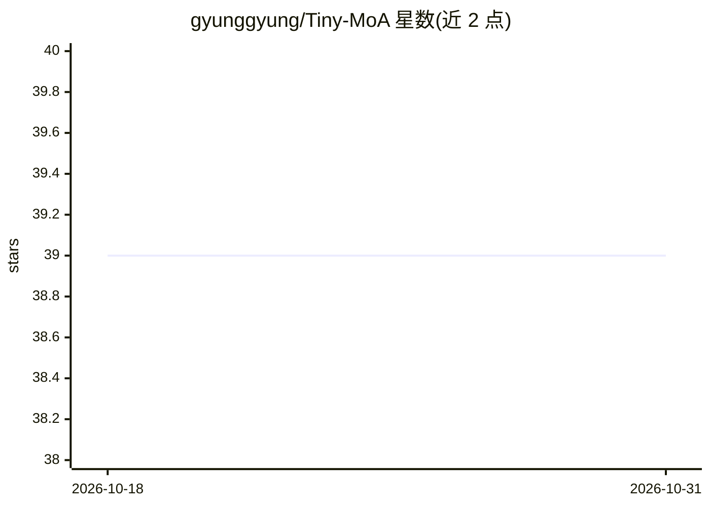

# gyunggyung/Tiny-MoA

⭐ 39 · Python · Apache-2.0 · 推送 2026-02-07 · [GitHub](https://github.com/gyunggyung/Tiny-MoA) · 个人维护

**CPU 上运行的多智能体系统：1.2B 主控 + 600M 推理 + 90M 工具调用**

面向无 GPU 环境用户的本地多智能体系统（MoA）：LFM2.5-1.2B-Thinking 作为 Brain 负责规划，Falcon-H1-0.6B Reasoner 与 Falcon-90M Tool Caller 协作执行任务。采用 English-First 策略，以英语推理、译回用户语言以兼顾速度与准确度。提供 Rich TUI 实时可视化协作过程，集成天气、DuckDuckGo 搜索、文件 RAG、系统控制等工具。模型总内存约 2GB，16GB RAM 的 CPU 环境即可运行；通过 git clone 源码 + uv/pip 安装依赖并自行下载 GGUF 模型。

## 筛选速览

| 维度 | 判定 | 备注 |
|---|---|---|
| AI 角色 | `ai-native` | 本体是模型或模型工具 |
| 许可风险 | `permissive` | Apache-2.0 |
| 部署形态 | `library` | 以包/库形式分发 |
| 模型依赖 | local-ok | 支持本地模型 |
| 硬件要求 | `cpu-ok` | |
| 安装摩擦 | `low` | 无编译、无系统依赖或容器化 |
| 成熟度 | — | 结构信号不足 |

## 能力要点

- 三模型分工：Brain 规划 + Reasoner + Tool Caller（总内存约 2GB）
- CPU-Only 运行，16GB RAM 即可，无需 GPU
- English-First 策略：英语推理后翻译回用户语言
- Rich TUI 实时任务看板与 Thinking 过程展示

## 适用场景

- 在没有 GPU 的电脑上本地运行多智能体助手
- 通过自然语言让 agent 调用天气、搜索、文件 RAG 等工具完成任务
- 以 TUI 观察 agent 间协作与思考过程

## 场景标签

`多智能体` `AI 助手` `RAG` · 领域:Agent 开发

## 证据(README 行号)

> L16: - 🧠 **Multi-Agent & Thinking**: LFM2.5-1.2B-Thinking (Brain)이 계획을 수립하고, Reasoner(600M)와 Tool Caller(90M)가 협업.
> L20: - ⚡ **GPU-Free**: 16GB RAM CPU 환경에서도 쾌적한 구동.

## 星数曲线

2026-10-18 39 → 2026-10-31 39（+0）

---
*卡片 v1 · prompt 1.4 · 生成 2026-10-25 · 置信度 mid · 依据 README sha `5ce189a09151` · [字段定义](../../DATASET.md)*
