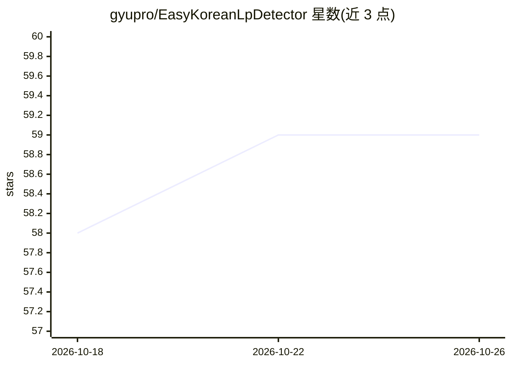

# gyupro/EasyKoreanLpDetector

⭐ 59 · Python · 推送 2026-04-27 · [GitHub](https://github.com/gyupro/EasyKoreanLpDetector) · 个人维护

**韩国车牌识别系统：车辆检测+车牌检测+OCR 三步流水线**

面向韩国车牌的检测与识别系统：输入图像先经 YOLO26s 检测车辆，再用 YOLOv5 权重检测车牌，最后 OCR 输出字符。车牌检测权重（约50MB）随项目打包，车辆检测权重首次运行时由 Ultralytics 自动下载；OCR 模型在 8 万车牌字符集上训练，数据源自 AIHUB 数据集与合成数据。通过 Streamlit 启动 Web 界面运行，支持 pip 与 uv 两种依赖安装方式。README 列出旧式车牌识别受限、车辆占满画面时可能漏检等限制。

## 筛选速览

| 维度 | 判定 | 备注 |
|---|---|---|
| AI 角色 | `ai-native` | 本体是模型或模型工具 |
| 许可风险 | `none` | — |
| 部署形态 | `library` | 以包/库形式分发 |
| 模型依赖 | — | README 未给出锁定关系 |
| 硬件要求 | — | 无带数字的原话,不猜 |
| 安装摩擦 | `low` | 无编译、无系统依赖或容器化 |
| 成熟度 | — | 结构信号不足 |

## 能力要点

- YOLO26s 车辆检测 + YOLOv5 车牌检测 + OCR 三段流水线
- 车牌检测权重随项目打包，车辆检测权重首次运行自动下载
- OCR 在 80,000 车牌字符集上训练，检测用 AIHUB 合成数据
- Streamlit Web 界面运行，支持 CPU 推理

## 适用场景

- 识别照片中的韩国车牌文字
- 在自有数据上继续训练改进识别效果
- 作为车牌 OCR 项目的参考实现

## 场景标签

`OCR` · 领域:感知与多模态

## 证据(README 行号)

> L9: Input Image -> Detect cars (YOLO26s) -> Detect Korean License Plate in Car (YOLOv5) -> OCR
> L43: * OCR is trained on 80,000 license plate - character set

## 星数曲线

2026-10-18 58 → 2026-10-26 59（+1）

---
*卡片 v1 · prompt 1.4 · 生成 2026-10-24 · 置信度 high · 依据 README sha `af05f4c8160f` · [字段定义](../../DATASET.md)*
