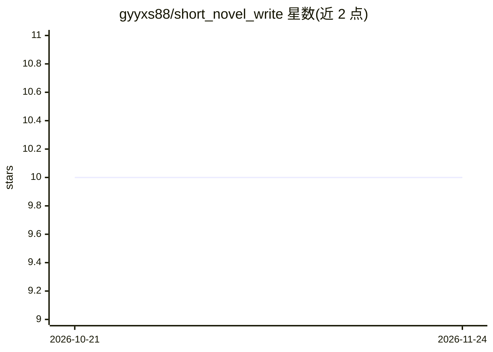

# gyyxs88/short_novel_write

⭐ 10 · Python · Apache-2.0 · 推送 2026-04-10 · [GitHub](https://github.com/gyyxs88/short_novel_write) · 个人维护 · 中文 README

**给 Agent/Skill 用的中文短篇小说生成工具链**

面向接入 agent/skill 工作流的中文短篇写作工具链，覆盖创意、方案、正文、检查、修订、归档全链路。Tool 层提供确定性动作：创意种子生成、SQLite 持久化与去重、结构与启发式质量检查、正文分析（重复短语、AI-ism 等）与 span 级局部改写。LLM 通道兼容 chat/completions 与 responses 接口，支持环境-候选模型链路自动切换、长稿分段生成与 token 统计。统一 CLI 以 stdin/stdout JSON 协议供 skill 后台调用，共四十五个 action。README 声明平台发布与自动投稿尚未落地，deterministic 基线不代表生产可用质量。

## 筛选速览

| 维度 | 判定 | 备注 |
|---|---|---|
| AI 角色 | `ai-native` | 本体是模型或模型工具 |
| 许可风险 | `permissive` | Apache-2.0 |
| 部署形态 | `desktop` | 安装包/桌面程序 |
| 模型依赖 | — | README 未给出锁定关系 |
| 硬件要求 | — | 无带数字的原话,不猜 |
| 安装摩擦 | `low` | 无编译、无系统依赖或容器化 |
| 成熟度 | `idea` | |

## 能力要点

- 统一 CLI 以 stdin/stdout JSON 协议暴露 45 个 action，面向 skill/agent 后台调用
- LLM 层支持环境-候选模型链路，前一个失败自动切换，不同阶段可用不同环境
- deterministic 正文分析与 span 级改写：去 AI 腔、压解释、情绪具象化、补场景
- SQLite 分层数据管理：运行库-归档库分离，保留 token 统计与修订轨迹

## 适用场景

- 把短篇写作流程接进自己的 agent/skill 工作流
- 批量并发生成多篇中文小说并统一归档对比
- 对已成稿的正文做去 AI 腔的自动修订与复检
- 继续维护或扩展这条写作链路的开发者

## 场景标签

`AI 写作` · 领域:内容生成

## 证据(README 行号)

> L3: 这是一个给 `Agent / Skill` 使用的中文短篇小说写作项目。
> L32:  通过 `tools/story_idea_pack_llm_builder.py` 调用兼容 `chat/completions` 或 `responses` 的上游模型接口生成首版 LLM 创意包，并与 determinist
> L45: 15. 统一 CLI

## 星数曲线

2026-10-21 10 → 2026-11-24 10（+0）

---
*卡片 v1 · prompt 1.4 · 生成 2026-11-19 · 置信度 high · 依据 README sha `d0809241869d` · [字段定义](../../DATASET.md)*
