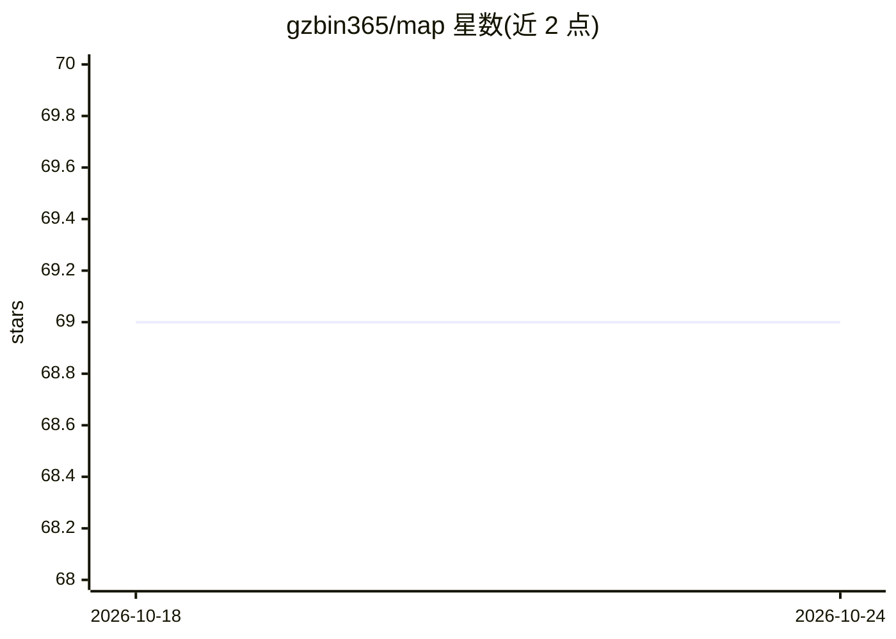

# gzbin365/map

⭐ 69 · GPL-2.0 · 推送 2026-10-08 · [GitHub](https://github.com/gzbin365/map) · [官网](https://gzbin.gitbook.io/map/) · 个人维护 · 中文 README

**算法工程师的个人网址导航与知识收藏夹**

个人维护的算法地图式网址导航：按搜索、常用工具、下载工具、学习课程、新闻博客、关注博主、工具等分类罗列大量网站链接，覆盖搜索引擎、文献资源（arxiv/Sci-Hub/谷歌学术）、课程平台（coursera/edx/慕课）、技术社区与博客、下载与效率工具等；另含指向 python/ml/nlp/cv/rl/math/linux 等备忘笔记 md 文件的链接。本质是个人知识库与收藏夹，无软件可安装运行。

## 筛选速览

| 维度 | 判定 | 备注 |
|---|---|---|
| AI 角色 | `ai-knowledge` | 知识聚合/清单类 |
| 许可风险 | `viral` | GPL-2.0 |
| 部署形态 | `None` |  |
| 模型依赖 | — | README 未给出锁定关系 |
| 硬件要求 | — | 无带数字的原话,不猜 |
| 安装摩擦 | `low` | 无编译、无系统依赖或容器化 |
| 成熟度 | — | 结构信号不足 |

## 能力要点

- 按搜索/工具/学习/博客等主题分类的网站链接集合
- 覆盖学术文献、在线课程、AI 博主等技术学习资源
- 附 python/ml/nlp/cv/rl/math 等个人学习笔记链接

## 适用场景

- 查找算法、机器学习相关的学习网站与课程入口
- 查找文献获取、下载工具、在线效率工具的网址
- 了解一位算法工程师整理的技术资源导航

## 场景标签

`精选清单` · 领域:学习与行业

## 证据(README 行号)

> L3: # 算法地图
> L45: |python.md|ml.md|linux.md|

## 星数曲线

2026-10-18 69 → 2026-10-24 69（+0）

---
*卡片 v1 · prompt 1.4 · 生成 2026-10-24 · 置信度 high · 依据 README sha `75f2abd89e6c` · [字段定义](../../DATASET.md)*
