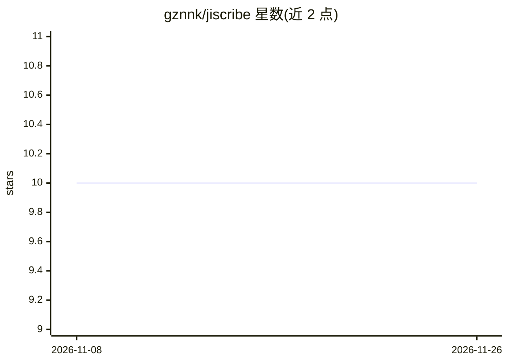

# gznnk/jiscribe

⭐ 10 · TypeScript · MIT · 推送 2026-11-25 · [GitHub](https://github.com/gznnk/jiscribe) · [官网](https://beta.jiscribe.dev) · 个人维护

**人与 AI agent 共同绘制的 SVG 画布：图表、原型、海报、文档**

Jiscribe 是一个 SVG 绘图画布，文档以普通对象存在于代码中、以纯 JSON（.jis）存于磁盘，人与 agent 通过同一文件协作编辑。agent 经 MCP server（stdio，84 个工具）逐条编辑而非整体重生成，可用 validate/diagnose/measure 在 Node 无头环境自查；本地 viewer 双向跟随文件写入。核心含 8 种图元，流程图/UML/ER/AWS 等形状集以插件提供。要求 Node 22+；另有 VSCode 扩展与浏览器版画布。

## 筛选速览

| 维度 | 判定 | 备注 |
|---|---|---|
| AI 角色 | `ai-enhanced` | 去掉 AI 部分产品仍成立 |
| 许可风险 | `permissive` | MIT |
| 部署形态 | `library` | 以包/库形式分发 |
| 模型依赖 | locked-api |  |
| 硬件要求 | — | 无带数字的原话,不猜 |
| 安装摩擦 | `low` | 无编译、无系统依赖或容器化 |
| 成熟度 | `idea` | |

## 能力要点

- MCP server 提供 84 个编辑工具，仅撤销 agent 自身的操作
- 导出 .jis.png 内嵌文档，图片即文档
- JSON Schema 与格式参考随形状集一同生成
- 无头 validate/diagnose/measure 与编辑器共用同一布局引擎

## 适用场景

- 让 agent 画架构图/流程图，再手动微调细节
- 在 VSCode 中把图表文件与代码放在一起编辑
- 浏览器里免安装手绘草图，文件留在本机

## 场景标签

 · 领域:图表/绘图工具

## 证据(README 行号)

> L7: An SVG engine that people and AI agents draw on together. Architecture
> L42: ## Built for agents, not bolted onto them
> L113: If you just want to draw something by hand without installing anything,

## 星数曲线

2026-11-08 10 → 2026-11-26 10（+0）

---
*卡片 v1 · prompt 1.4 · 生成 2026-11-19 · 置信度 mid · 依据 README sha `81901a252b38` · [字段定义](../../DATASET.md)*
