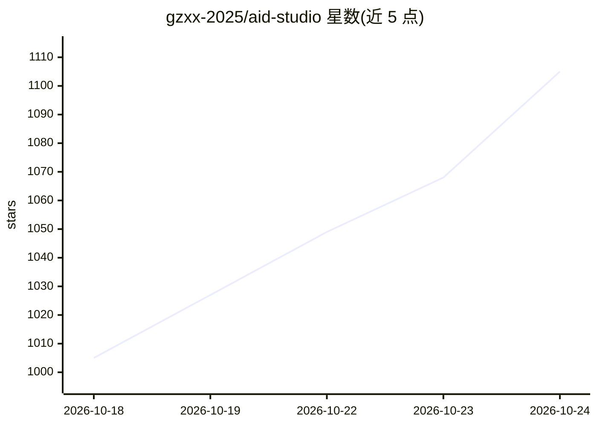

# gzxx-2025/aid-studio

⭐ 1,105 · Java · MIT · 推送 2026-10-22 · [GitHub](https://github.com/gzxx-2025/aid-studio) · [官网](https://www.aidstudio.com.cn/) · 组织维护 · 中文 README

**自托管 AI 漫剧/短剧/电影/漫画创作平台**

开源、可自行部署的 AI 动态漫画与短剧创作平台，覆盖剧本、角色场景资产、分镜工作台、文生图/图生图、图生视频、多音色 TTS 配音与成片预览的端到端流程。支持多模型接入与统一 Providers 编排，可配置文本、图片、视频、语音模型，需自行提供各服务商 API 凭据并承担调用成本。平台侧提供任务队列、计费、用户账号与管理后台，通过 Docker 或 systemd 部署于 64 位 Linux 服务器，最低 2 核/4GB 内存/40GB 磁盘。

## 筛选速览

| 维度 | 判定 | 备注 |
|---|---|---|
| AI 角色 | `ai-native` | 本体是模型或模型工具 |
| 许可风险 | `permissive` | MIT |
| 部署形态 | `self-host` | docker 或自建部署 |
| 模型依赖 | — | README 未给出锁定关系 |
| 硬件要求 | — | 无带数字的原话,不猜 |
| 安装摩擦 | `low` | 无编译、无系统依赖或容器化 |
| 成熟度 | — | 结构信号不足 |

## 能力要点

- 端到端流程：剧本→分镜→图片→视频→配音→成片预览
- 多模型编排：文本/图片/视频/语音模型统一配置，含 API 网关
- 统一任务系统：生成队列、并发调度、重试与结果检索
- Docker/systemd 部署，含模型、用户、计费与升级管理（aid-updater）

## 适用场景

- 制作 AI 动态漫画或短剧并配音成片
- 团队自托管 AI 内容创作平台并配置自有模型
- 生成静态漫画的分镜图与角色资产

## 场景标签

`图像生成` `视频生成` `语音合成` · 领域:内容生成

## 证据(README 行号)

> L5: **AID Studio is an open-source AI motion comic creation platform for AI short dramas, films and comics, with an end-
> L62: |**AI motion comics / short dramas**|Episode scripts, character and scene assets, storyboard images, video clips, c

## 星数曲线

2026-10-18 1,005 → 2026-10-24 1,105（+100）

---
*卡片 v1 · prompt 1.4 · 生成 2026-10-21 · 置信度 high · 依据 README sha `340bda400777` · [字段定义](../../DATASET.md)*
