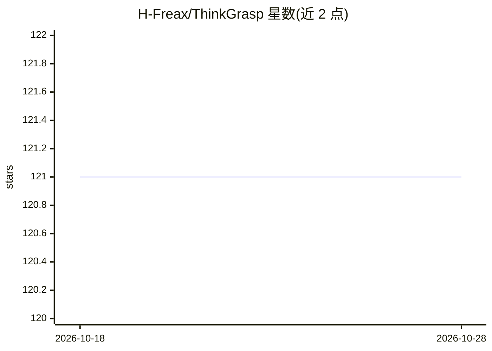

# H-Freax/ThinkGrasp

⭐ 121 · Python · MIT · 推送 2026-10-25 · [GitHub](https://github.com/H-Freax/ThinkGrasp) · [官网](https://h-freax.github.io/thinkgrasp_page/) · 组织维护

**视觉语言系统：杂乱场景中按语言指令抓取目标部件**

CoRL 2024 论文 ThinkGrasp 的官方代码库，面向机器人抓取研究者。系统结合 GPT-4 与视觉语言模型（LangSAM/VLPart 等），在杂乱堆叠场景中按文本目标描述策略性移除遮挡物并抓取目标部件。提供 PyBullet 仿真与真实机械臂两条路径，真实部署通过 Flask 提供 /grasp_pose HTTP 端点接收 RGB/深度图与目标文本。运行需 Ubuntu 23.04、CUDA 11.8 与 GTX 3090 级 GPU（完整版建议双卡），安装流程较复杂。

## 筛选速览

| 维度 | 判定 | 备注 |
|---|---|---|
| AI 角色 | `ai-native` | 本体是模型或模型工具 |
| 许可风险 | `permissive` | MIT |
| 部署形态 | `library` | 以包/库形式分发 |
| 模型依赖 | — | README 未给出锁定关系 |
| 硬件要求 | `gpu-8g` | |
| 安装摩擦 | `high` | 编译与系统依赖俱全 |
| 成熟度 | — | 结构信号不足 |

## 能力要点

- GPT-4 结合视觉语言模型做目标部件推理与抓取
- PyBullet 仿真与真实机械臂两套运行路径
- Flask 提供 /grasp_pose API 接收 RGB/深度图与目标文本
- 被多篇后续论文用作 baseline

## 适用场景

- 在仿真中复现杂乱场景语言条件抓取实验
- 在真实机械臂上按文本指令抓取指定部件
- 作为视觉语言抓取研究的对比 baseline

## 场景标签

`多模态` · 领域:感知与多模态

## 证据(README 行号)

> L1: # [CoRL 2024] ThinkGrasp: A Vision-Language System for Strategic Part Grasping in Clutter
> L3: Welcome to the official repository for **ThinkGrasp: A Vision-Language System for Strategic Part Grasping in Clutter
> L121: 2. **Set Your OpenAI API Key**:

## 星数曲线

2026-10-18 121 → 2026-10-28 121（+0）

---
*卡片 v1 · prompt 1.4 · 生成 2026-10-23 · 置信度 high · 依据 README sha `71c7dbe1f0e8` · [字段定义](../../DATASET.md)*
