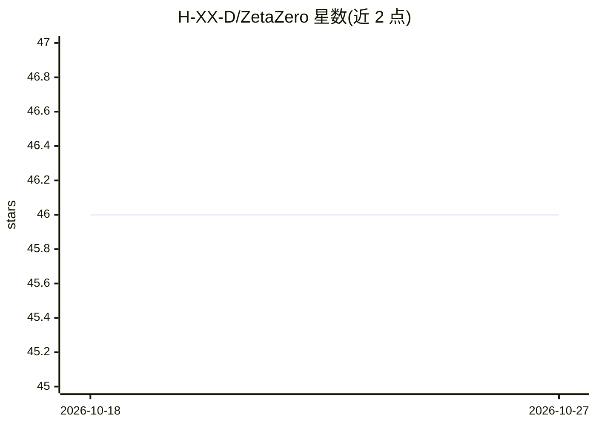

# H-XX-D/ZetaZero

⭐ 46 · C++ · Apache-2.0 · 推送 2026-02-13 · [GitHub](https://github.com/H-XX-D/ZetaZero) · 个人维护

**本地 LLM 的持久记忆认知框架：把上下文存为知识图谱**

基于 C++ 与 llama.cpp 的认知架构框架，面向本地 LLM。将对话与推理结果持久化为知识图谱而非一次性上下文窗口，通过嵌入相似度检索历史内容；协调三个模型分工（14B 推理、7B 编码、嵌入模型记忆）。空闲时进入 Dream State 做记忆整合并在代码库上生成 insight 输出。README 提供自有基准数据（50 轮对话 4.6x 更快、11x 更省能，硬件为 RTX 5060 Ti + Qwen2.5 14B），并描述 SHA-256 绑定伦理宪法机制。提供 quickstart 脚本与 Docker 镜像。

## 筛选速览

| 维度 | 判定 | 备注 |
|---|---|---|
| AI 角色 | `ai-ecosystem` | LLM/agent 周边工具 |
| 许可风险 | `permissive` | Apache-2.0 |
| 部署形态 | `self-host` | docker 或自建部署 |
| 模型依赖 | — | README 未给出锁定关系 |
| 硬件要求 | — | 无带数字的原话,不猜 |
| 安装摩擦 | `low` | 无编译、无系统依赖或容器化 |
| 成熟度 | — | 结构信号不足 |

## 能力要点

- 持久知识图谱替代上下文窗口，按嵌入相似度检索
- 三模型分工架构：14B 推理 / 7B 编码 / 嵌入模型记忆
- 空闲时 Dream State 做记忆整理并输出 code_fix / code_idea / insight
- 伦理宪法经 SHA-256 哈希与权重绑定（Silicon Accord）

## 适用场景

- 在本地跑长对话 LLM 而不随轮数线性增长上下文
- 让本地模型在空闲时整理记忆并产出代码库洞察
- 需要多模型协同（推理+编码+记忆检索）的本地部署

## 场景标签

`知识图谱` `Agent 记忆` · 领域:Agent 开发

## 证据(README 行号)

> L45: **Z.E.T.A. is not a model. It is a Framework for Cognitive Constructs.**
> L106: They share a persistent knowledge graph—not a context window. When one model learns something, the others can retr

## 星数曲线

2026-10-18 46 → 2026-10-27 46（+0）

---
*卡片 v1 · prompt 1.4 · 生成 2026-10-25 · 置信度 mid · 依据 README sha `997dca4c31f7` · [字段定义](../../DATASET.md)*
