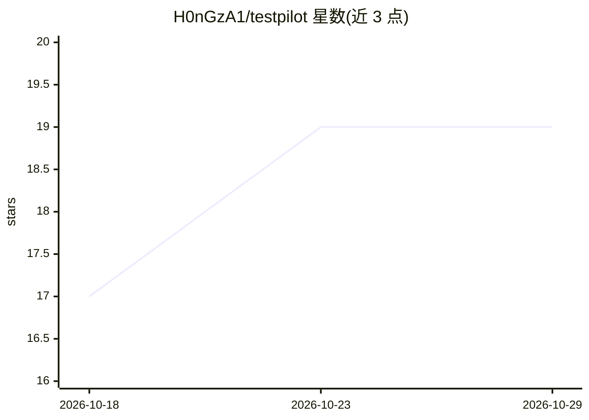

# H0nGzA1/testpilot

⭐ 19 · Python · MIT · 推送 2026-09-08 · [GitHub](https://github.com/H0nGzA1/testpilot) · 个人维护 · 中文 README

**自然语言 E2E 测试平台：浏览器 agent 执行、LLM 裁决通过与否**

面向 Web 应用测试的自托管平台：测试用例以自然语言编写，由 browser-use 驱动的浏览器 agent 在真实 Chromium 中执行，采集 mp4 视频、逐步截图与操作历史，交由 LLM judge 依据证据给出 pass/fail 及理由，证据不足默认判失败。支持任意 OpenAI 兼容端点（含本地 VLM，运行时可改配置无需重部署）、并发执行与浏览器预算、会话复用、失败用例转 Kanban 工单、可选 GitLab/飞书集成与多用户权限。本地开发需 Python 3.11+、Node 20 + pnpm；Docker 单镜像部署内置 Postgres/Redis 与 Chromium。

## 筛选速览

| 维度 | 判定 | 备注 |
|---|---|---|
| AI 角色 | `ai-native` | 本体是模型或模型工具 |
| 许可风险 | `permissive` | MIT |
| 部署形态 | `self-host` | docker 或自建部署 |
| 模型依赖 | — | README 未给出锁定关系 |
| 硬件要求 | — | 无带数字的原话,不猜 |
| 安装摩擦 | `low` | 无编译、无系统依赖或容器化 |
| 成熟度 | — | 结构信号不足 |

## 能力要点

- 自然语言用例 + browser-use/Playwright/CDP 真实浏览器执行
- LLM-as-judge 依据视频/截图/操作历史给出 pass/fail 与理由，证据不足默认失败
- 任意 OpenAI 兼容端点运行时可配（含可选本地 agent 模型），无需重部署
- 内置 Kanban 工单、可选 GitLab 双向同步与飞书机器人

## 适用场景

- 用自然语言编写并执行 Web 应用端到端测试
- CI 中跑回归测试并回放失败用例的视频与操作轨迹
- 把失败用例转为工单跟踪并同步到 GitLab/飞书

## 场景标签

`浏览器自动化` · 领域:效率与自动化

## 证据(README 行号)

> L17: natural-language case ──▶ browser agent (browser-use → Playwright/CDP → Chromium)
> L20:                           LLM judge ──▶ pass / fail + reason ──▶ aggregated run report
> L50: - **Bring your own model** — any OpenAI-compatible endpoint; base URL / key / models are configurable at runtime in

## 星数曲线

2026-10-18 17 → 2026-10-29 19（+2）

---
*卡片 v1 · prompt 1.4 · 生成 2026-10-29 · 置信度 high · 依据 README sha `94215fb9b887` · [字段定义](../../DATASET.md)*
