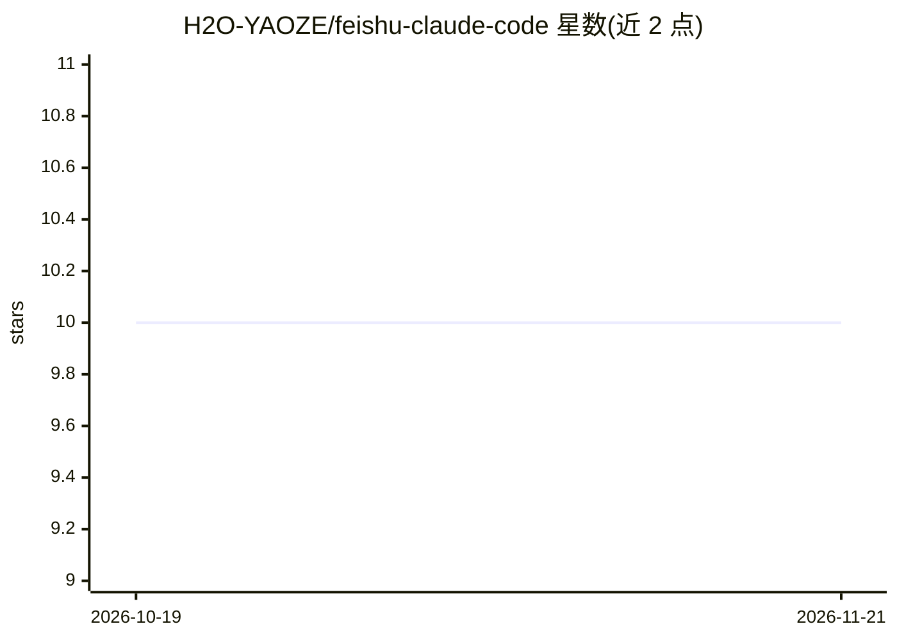

# H2O-YAOZE/feishu-claude-code

⭐ 10 · Python · MIT · 推送 2026-06-02 · [GitHub](https://github.com/H2O-YAOZE/feishu-claude-code) · 个人维护 · 中文 README

**把 Claude Code 接入飞书的桥接机器人：手机遥控本机跑代码**

以 Python 编写的桥接服务：通过 lark-cli WebSocket 长连接接收飞书消息，以 stream-json 调用本机 claude CLI 执行任务，回复经流式卡片输出。支持文本/图片/文件/语音/转发等消息类型，自动解析飞书文档链接嵌入上下文，长回复写入飞书文档，生成文件回传至飞书 Drive。提供会话跨设备恢复、群聊独立 session、休眠重连与 launchd 保活。前置条件为 Python 3.11+、Claude Code CLI 与 Claude Max/Pro 订阅。README 提示 Bot 会读取用户发送的文档链接内容。

## 筛选速览

| 维度 | 判定 | 备注 |
|---|---|---|
| AI 角色 | `ai-ecosystem` | LLM/agent 周边工具 |
| 许可风险 | `permissive` | MIT |
| 部署形态 | `library` | 以包/库形式分发 |
| 模型依赖 | — | README 未给出锁定关系 |
| 硬件要求 | — | 无带数字的原话,不猜 |
| 安装摩擦 | `low` | 无编译、无系统依赖或容器化 |
| 成熟度 | — | 结构信号不足 |

## 能力要点

- WebSocket 长连接收消息，不暴露公网端口
- 支持文件/语音/转发等消息类型与文档链接自动解析
- 长回复自动写入飞书文档，生成文件回传 Drive
- 会话跨设备恢复与按群绑定工作目录

## 适用场景

- 出门时用飞书消息遥控家里电脑执行编码任务
- 在飞书群聊中让 Claude 读取并分析共享文档
- 手机上开始的会话回到电脑前继续

## 场景标签

`编码 Agent` `聊天机器人` · 领域:编码与开发

## 证据(README 行号)

> L57: │  飞书 App │◄───────────►│ feishu-bridge   │─────────────►│ claude CLI │
> L64: - **发消息走 Python SDK (lark_oapi)**：租户 token，流式卡片 patch

## 星数曲线

2026-10-19 10 → 2026-11-21 10（+0）

---
*卡片 v1 · prompt 1.4 · 生成 2026-11-20 · 置信度 mid · 依据 README sha `72d66469f80f` · [字段定义](../../DATASET.md)*
