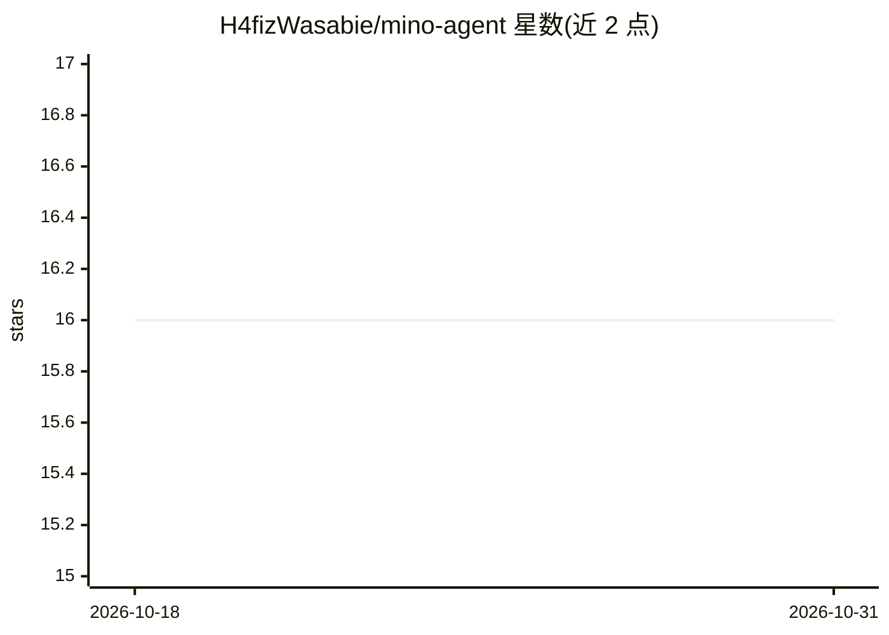

# H4fizWasabie/mino-agent

⭐ 16 · Go · MIT · 推送 2026-09-03 · [GitHub](https://github.com/H4fizWasabie/mino-agent) · 个人维护

**自托管个人 AI 助手：单二进制+SQLite，带记忆与定时工作流**

单个 Go 二进制与本地 SQLite 状态文件构成的个人 AI agent，面向自托管用户。提供仪表盘与 Telegram 两种交互入口；核心机制包括 Markdown 权威的图记忆（情景/语义分离、30 天过期归档）、可编排定时执行的 Playbook 工作流（阶段契约、产出验证）、编码与 bash 等工具。模型接入兼容任意 OpenAI 兼容 API，支持 OAuth 登录 Claude/Codex/Copilot/xAI，本地可接 Ollama/LM Studio/vLLM，含 MCP 扩展与 sudoers 白名单的受限主机权限。安装为下载二进制或 Go 1.25+ 源码构建，无 CGo 与系统依赖。

## 筛选速览

| 维度 | 判定 | 备注 |
|---|---|---|
| AI 角色 | `ai-native` | 本体是模型或模型工具 |
| 许可风险 | `permissive` | MIT |
| 部署形态 | `desktop` | 安装包/桌面程序 |
| 模型依赖 | local-ok | 支持本地模型 |
| 硬件要求 | — | 无带数字的原话,不猜 |
| 安装摩擦 | `low` | 无编译、无系统依赖或容器化 |
| 成熟度 | — | 结构信号不足 |

## 能力要点

- 单 Go 二进制 + 本地 SQLite 状态，无系统依赖与 CGo
- Markdown 权威图记忆：情景/语义分离、每日全量重建、只读审计命令
- Playbook 可验证工作流：阶段契约、产出验证、定时运行与 Telegram 报告
- 多 provider 接入：优先级/熔断/回退、OpenRouter 路由、OAuth 与本地 LLM

## 适用场景

- 自托管一个跨设备（网页+Telegram）可用的个人 AI 助手
- 教会 agent 一项任务后按计划自动执行并验证产出
- 用 OpenAI 兼容 API 或本地 Ollama/vLLM 模型驱动日常编码与运维工作

## 场景标签

`AI 助手` `工作流自动化` · 领域:效率与自动化

## 证据(README 行号)

> L3: Mino remembers what matters, uses tools to get work done, and turns repeatable work into verified workflows that run
> L5: It is a single Go binary with a local SQLite state file. Conversations, memory, playbooks, schedules, costs, and the
> L23: - **Dashboard** — chat, memory, tools, database, ops

## 星数曲线

2026-10-18 16 → 2026-10-31 16（+0）

---
*卡片 v1 · prompt 1.4 · 生成 2026-10-30 · 置信度 mid · 依据 README sha `6b73430dcaf4` · [字段定义](../../DATASET.md)*
