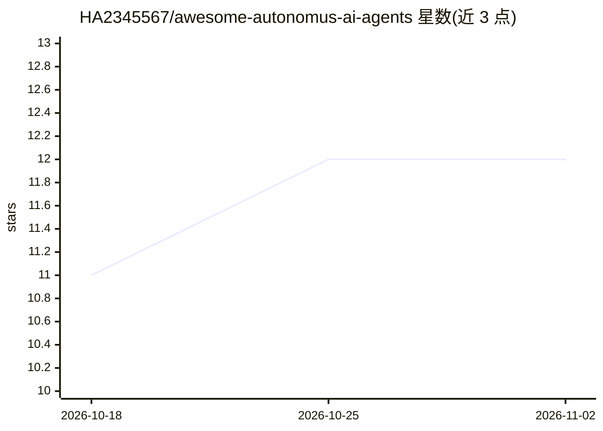

# HA2345567/awesome-autonomus-ai-agents

⭐ 12 · NOASSERTION · 推送 2026-10-30 · [GitHub](https://github.com/HA2345567/awesome-autonomus-ai-agents) · [官网](https://github.com/HA2345567/awesome-autonomus-ai-agents) · 个人维护

**自主 AI Agent 生态策展清单：380+ 框架、协议与设计模式**

名为 NEXUM 的 awesome list（2026 Edition），按 8 层架构组织收录 380+ 自主 AI agent 生态条目：前沿模型、编排框架（LangGraph、CrewAI、AutoGen 等）、编码 agent、微代理 SDK、沙箱运行时、MCP 协议、垂直行业 agent、安全治理标准（OWASP ASI Top 10）与商业结算协议。条目附许可与标签，面向开发与选型的浏览式知识目录，不提供可运行软件本体，内容含大量 2025-2026 前瞻性条目，需读者自行核验。

## 筛选速览

| 维度 | 判定 | 备注 |
|---|---|---|
| AI 角色 | `ai-knowledge` | 知识聚合/清单类 |
| 许可风险 | `permissive` | NOASSERTION |
| 部署形态 | `library` | 以包/库形式分发 |
| 模型依赖 | — | README 未给出锁定关系 |
| 硬件要求 | — | 无带数字的原话,不猜 |
| 安装摩擦 | `low` | 无编译、无系统依赖或容器化 |
| 成熟度 | — | 结构信号不足 |

## 能力要点

- 380+ 条目按 8 层 NEXUM 架构组织
- 覆盖编排框架、编码 agent、沙箱运行时、MCP 协议等类别
- 收录 OWASP ASI Top 10 等安全治理标准与商业结算协议
- MIT 许可、开放 PR 收录

## 适用场景

- 调研自主 agent 框架与工具的选型目录
- 了解 agent 生态分层架构与安全治理标准
- 查找编码 agent、沙箱运行时等基础设施组件

## 场景标签

`精选清单` · 领域:学习与行业

## 证据(README 行号)

> L4:  Architecting the Autonomous Frontier • 380+ Curated Agents, Orchestration Frameworks, Sandboxes, Protocols & Design
> L60: ## 03. The Agentic Stack

## 星数曲线

2026-10-18 11 → 2026-11-02 12（+1）

---
*卡片 v1 · prompt 1.4 · 生成 2026-11-01 · 置信度 mid · 依据 README sha `79f25c963b56` · [字段定义](../../DATASET.md)*
