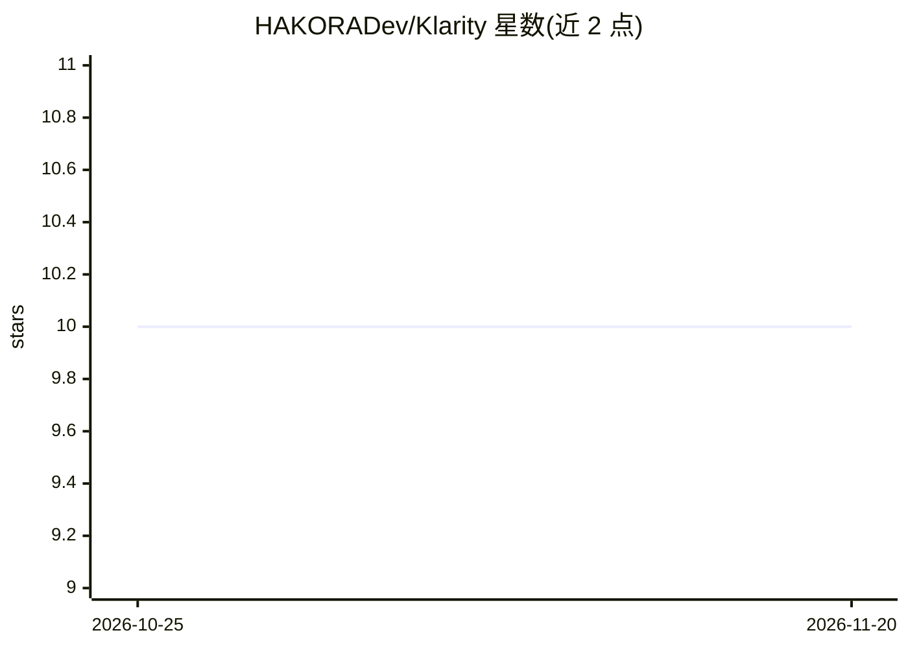

# HAKORADev/Klarity

⭐ 10 · Python · MIT · 推送 2026-09-30 · [GitHub](https://github.com/HAKORADev/Klarity) · 组织维护

**本地离线 AI 图像/视频修复工具箱：降噪、去模糊、超分、补帧**

本地运行的免费离线图像/视频修复工具，提供 9 种处理模式（降噪、去模糊、2x/4x 放大、组合管线、AI 补帧），底层集成 NAFNet、Real-HAT-GAN/Real-ESRGAN、RIFE 等开源模型。提供 GUI、交互式 CLI 与直接命令三种使用方式，分 Heavy/Lite 双模型档位（模型下载约 888MB/204MB，最低内存 8-16GB/4GB）。Windows/Linux 提供 CPU 预编译二进制，也可从源码运行；视频处理需安装 FFmpeg。

## 筛选速览

| 维度 | 判定 | 备注 |
|---|---|---|
| AI 角色 | `ai-native` | 本体是模型或模型工具 |
| 许可风险 | `permissive` | MIT |
| 部署形态 | `None` |  |
| 模型依赖 | — | README 未给出锁定关系 |
| 硬件要求 | `gpu-8g` | |
| 安装摩擦 | `medium` | 含编译或系统依赖之一 |
| 成熟度 | — | 结构信号不足 |

## 能力要点

- 9 种处理模式覆盖降噪、去模糊、超分与帧生成
- Heavy/Lite 双模型档位（NAFNet/Real-HAT-GAN/Real-ESRGAN/RIFE）
- Windows/Linux 预编译 CPU 二进制，无需 Python 环境
- GUI、交互式 CLI 与直接命令三种使用方式

## 适用场景

- 批量给老照片或视频降噪、去模糊
- 把低分辨率图片或视频放大 2x/4x
- 将低帧率游戏录像插帧到 60FPS
- 无订阅费、离线处理视觉素材

## 场景标签

`图像视频处理` · 领域:感知与多模态

## 证据(README 行号)

> L15: **Klarity** is a local, free, offline AI-powered image and video restoration tool that delivers professional-grade 
> L79: - **Denoising:** NAFNet-SIDD — Neural networks for noise reduction
> L116: |**GPU**|None (CPU works)|NVIDIA GTX 1060+|

## 星数曲线

2026-10-25 10 → 2026-11-20 10（+0）

---
*卡片 v1 · prompt 1.4 · 生成 2026-11-20 · 置信度 high · 依据 README sha `a8d437bbf4bc` · [字段定义](../../DATASET.md)*
