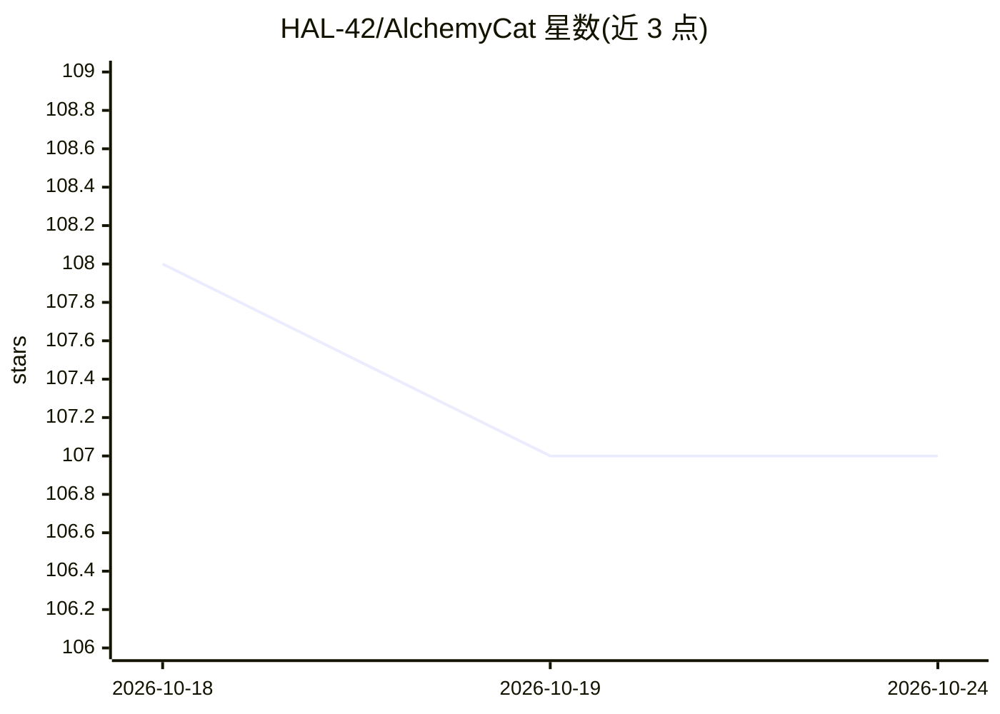

# HAL-42/AlchemyCat

⭐ 107 · Python · Apache-2.0 · 推送 2025-12-18 · [GitHub](https://github.com/HAL-42/AlchemyCat) · [官网](https://github.com/HAL-42/AlchemyCat) · 个人维护 · 中文 README

**面向机器学习研究的 Python 配置系统与自动调参工具**

以 Python 字典子类 Config 为核心的配置系统，支持配置继承（含链式与多继承）、组合、子树覆盖与配置项间依赖同步，加载时自动创建与配置路径镜像的实验目录以保证可复现。提供参数自动调优器 Cfg2TuneRunner，可对参数空间并行网格搜索并汇总实验结果，无需修改原配置或训练代码；可直接读写 YAML/YACS/MMCV 配置并提供格式互转脚本。以 pip 包形式安装，面向深度学习研究者，示例基于 MMSeg/torchvision。

## 筛选速览

| 维度 | 判定 | 备注 |
|---|---|---|
| AI 角色 | `ai-ecosystem` | LLM/agent 周边工具 |
| 许可风险 | `permissive` | Apache-2.0 |
| 部署形态 | `library` | 以包/库形式分发 |
| 模型依赖 | — | README 未给出锁定关系 |
| 硬件要求 | — | 无带数字的原话,不猜 |
| 安装摩擦 | `low` | 无编译、无系统依赖或容器化 |
| 成熟度 | — | 结构信号不足 |

## 能力要点

- 配置继承/组合/依赖同步，一次修改全局联动
- Cfg2TuneRunner 并行搜索参数空间并自动汇总结果，无需改动原训练代码
- 直接读写 YAML/YACS/MMCV 配置并提供格式互转脚本
- 配置与实验目录一一映射，实验目录自动生成

## 适用场景

- 管理深度学习实验配置并保证结果可复现
- 对超参数做网格搜索并自动汇总各组合实验结果
- 从 YAML/YACS/MMCV 配置体系直接接入而无需迁移

## 场景标签

`MLOps` · 领域:训练与推理

## 证据(README 行号)

> L27: AlchemyCat is a config system designed for machine learning research to address such issues. It helps researchers t
> L53: AlchemyCat offers an auto parameter-tuner that seamlessly integrates with existing config systems to explore the hy

## 星数曲线

2026-10-18 108 → 2026-10-24 107（-1）

---
*卡片 v1 · prompt 1.4 · 生成 2026-10-23 · 置信度 high · 依据 README sha `1d64e0ec9406` · [字段定义](../../DATASET.md)*
