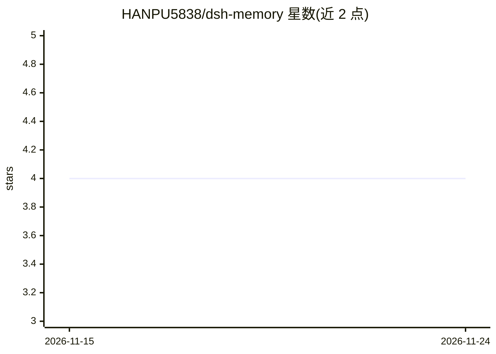

# HANPU5838/dsh-memory

⭐ 5 · TypeScript · MIT · 推送 2026-11-22 · [GitHub](https://github.com/HANPU5838/dsh-memory) · 个人维护 · 中文 README

**给 DeepSeek Harness 提供本地长期记忆的插件**

以 DSH 插件形式运行的本地优先长期记忆系统：Agent 通过八个工具读写记忆，每轮自动检索相关记忆并压缩注入上下文。检索层组合词法 BM25、可选 bge-m3 向量、图增强多跳（PPR）与 PRF 查询扩展，经 RRF 融合；记忆带 FSRS 式强度排序、语义合并、冲突裁决与周期巩固。数据存于本机 JSONL，不配置向量后端时零网络请求；跨平台适配 Termux/Linux/macOS/Windows，向量运行时可由面板一键安装。要求宿主 DSH 与 Node ≥ 22.13。

## 筛选速览

| 维度 | 判定 | 备注 |
|---|---|---|
| AI 角色 | `ai-ecosystem` | LLM/agent 周边工具 |
| 许可风险 | `permissive` | MIT |
| 部署形态 | `None` |  |
| 模型依赖 | local-ok | 支持本地模型 |
| 硬件要求 | — | 无带数字的原话,不猜 |
| 安装摩擦 | `low` | 无编译、无系统依赖或容器化 |
| 成熟度 | — | 结构信号不足 |

## 能力要点

- 多路检索：BM25 + bge-m3 向量 + PPR 图增强 + PRF 扩展，RRF 融合
- 记忆生命周期：FSRS 式强度、休眠、软删、语义合并与冲突裁决
- 面板提供知识树、关系分析、注入审计与向量后端一键安装
- 无向量后端时退化为纯词法检索，零网络请求

## 适用场景

- 让 Agent 跨会话记住偏好、事实与决策并自动召回
- 多项目/多会话隔离管理 Agent 记忆
- 在无网络环境下运行本地记忆库
- 通过审计面板核查每轮记忆注入的决策链

## 场景标签

`Agent 记忆` · 领域:Agent 开发

## 证据(README 行号)

> L3: **给 DeepSeek Harness 的本地优先长期记忆插件：多路检索 + 多跳图增强 + 上下文摘要 + 冲突消解**
> L19: DSH 记忆系统是一个**完全本地**的长期记忆插件：Agent 用八个工具读写记忆，插件在每一轮把相关记忆
> L140: 要求：**DSH + Node ≥ 22.13**。插件通过 GitHub 安装，不依赖 npm 发布。

## 星数曲线

2026-11-15 4 → 2026-11-24 4（+0）

---
*卡片 v1 · prompt 1.4 · 生成 2026-11-21 · 置信度 high · 依据 README sha `4eb1df4668a5` · [字段定义](../../DATASET.md)*
