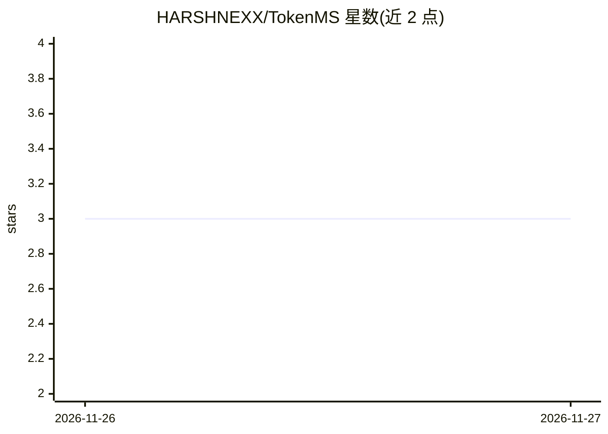

# HARSHNEXX/TokenMS

⭐ 3 · Python · NOASSERTION · 推送 2026-11-24 · [GitHub](https://github.com/HARSHNEXX/TokenMS) · 个人维护

**给 AI 编码代理提供本地代码检索与压缩上下文的 MCP 服务**

以 Model Context Protocol 服务形式本地运行的代码上下文管理工具：通过 Tree-sitter 将仓库解析为 AST 符号图并映射跨模块关系，用 BM25 词法搜索、Personalized PageRank 图遍历与本地 Model2Vec 嵌入混合检索，再以 Knapsack 优化在给定 token 预算内组装任务所需符号。全程在本地 CPU 与 SQLite（WAL）上运行，无需 API key 或云依赖。提供 11 个 MCP 工具（上下文解析、查询、AST 校验编辑、批量编辑、大纲、基准测试等），README 给出基于 17 个任务的自测基准数据，支持 Python 3.11+。

## 筛选速览

| 维度 | 判定 | 备注 |
|---|---|---|
| AI 角色 | `ai-ecosystem` | LLM/agent 周边工具 |
| 许可风险 | `permissive` | NOASSERTION |
| 部署形态 | `None` |  |
| 模型依赖 | — | README 未给出锁定关系 |
| 硬件要求 | — | 无带数字的原话,不猜 |
| 安装摩擦 | `low` | 无编译、无系统依赖或容器化 |
| 成熟度 | — | 结构信号不足 |

## 能力要点

- 基于 Tree-sitter 的多语言 AST 解析（Python/TypeScript/JavaScript/Rust/Dart）
- BM25+PPR 图遍历+本地 Model2Vec 嵌入的混合检索与 Knapsack 预算控制
- 支持事务性 AST 编辑、两阶段预检/回滚的批量编辑
- 完全本地运行，无需外部 API key 或云依赖

## 适用场景

- 为 Cursor/Claude Desktop 等 MCP 客户端提供精简代码上下文
- 降低 AI 编码代理在大型代码库中的探索性 token 消耗
- monorepo 中追踪跨模块依赖与 schema 演进

## 场景标签

`语义搜索` · 领域:知识与检索

## 证据(README 行号)

> L9: Protocol: MCP
> L36: **TMS** runs locally alongside your editor as a Model Context Protocol (MCP) service. It parses your repository int
> L46: * **Local-First & Zero Cloud Cost:** Runs entirely on your CPU using SQLite with Write-Ahead Logging (WAL) and loca

## 星数曲线

2026-11-26 3 → 2026-11-27 3（+0）

---
*卡片 v1 · prompt 1.4 · 生成 2026-11-26 · 置信度 high · 依据 README sha `654f72795db9` · [字段定义](../../DATASET.md)*
