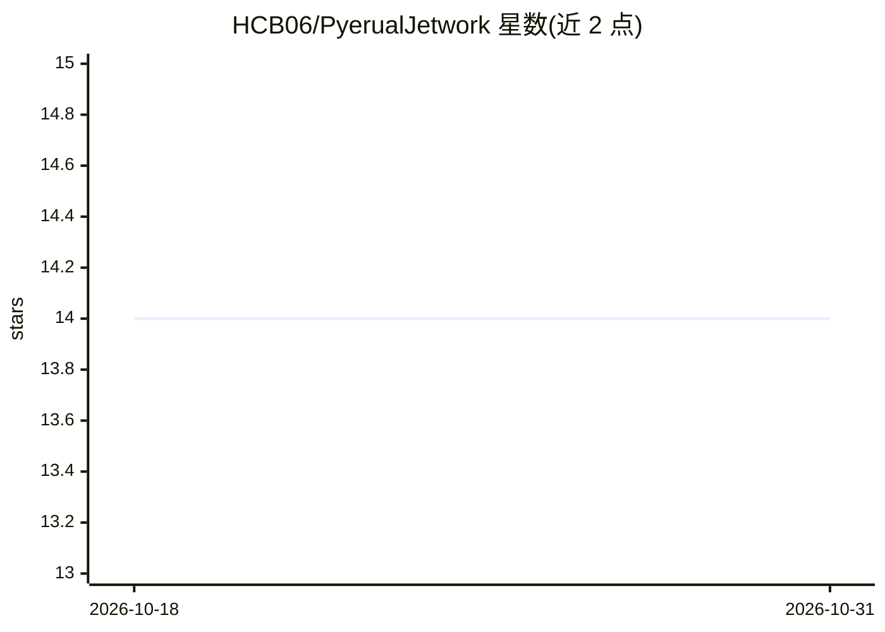

# HCB06/PyerualJetwork

⭐ 14 · Python · Apache-2.0 · 推送 2026-03-31 · [GitHub](https://github.com/HCB06/PyerualJetwork) · [官网](https://www.youtube.com/@HasanCanBeydili) · 个人维护

**面向专业人士与研究者的 GPU 加速 Python 机器学习库（PLAN/MLP/PTNN/ENE）**

作者自研的 GPU 加速 + 多线程深度学习库，包含 PLAN 分类算法、经典 MLP 与 PTNN 训练、以及用于遗传优化和强化学习的 ENE（Eugenic NeuroEvolution）模块；另提供数据预处理、可视化、模型保存加载、预测评估与内存管理函数。设计上仅用函数实现，同时支持类 eager 执行（类似 PyTorch）与静态图（类似 TensorFlow）两种使用方式，可在 GPU/CPU 间迁移数据。依赖 cupy-cuda12x 实现 GPU 加速，通过 pip 安装，附论文链接（PLAN 首版）。

## 筛选速览

| 维度 | 判定 | 备注 |
|---|---|---|
| AI 角色 | `ai-native` | 本体是模型或模型工具 |
| 许可风险 | `permissive` | Apache-2.0 |
| 部署形态 | `library` | 以包/库形式分发 |
| 模型依赖 | — | README 未给出锁定关系 |
| 硬件要求 | — | 无带数字的原话,不猜 |
| 安装摩擦 | `medium` | 含编译或系统依赖之一 |
| 成熟度 | — | 结构信号不足 |

## 能力要点

- 自研 PLAN 分类算法与 ENE 遗传优化算法，附 SSRN 论文与 PLAN.pdf 文档
- 支持 PLAN VISION 计算机视觉与 NLPlan 自然语言处理建模
- 同时支持 eager 执行与静态图两种编程概念
- 提供 Issue Solver 应对大版本更新的兼容性问题

## 适用场景

- 用 PLAN/MLP/PTNN 做分类、视觉与 NLP 任务建模
- 用 ENE 模块做遗传优化与强化学习
- 在 GPU/CPU 之间管理数据并训练模型

## 场景标签

`强化学习` `模型训练` · 领域:训练与推理

## 证据(README 行号)

> L56: PyereualJetwork is a large wide GPU-accelerated + Parallel Threading Supported deep learning library in Python desi
> L59: The library includes functions for data pre-processing, visualizations, model saving and loading, prediction and ev

## 星数曲线

2026-10-18 14 → 2026-10-31 14（+0）

---
*卡片 v1 · prompt 1.4 · 生成 2026-10-31 · 置信度 high · 依据 README sha `fb034ca0de3c` · [字段定义](../../DATASET.md)*
