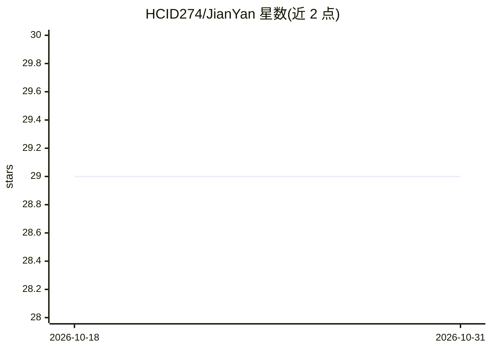

# HCID274/JianYan

⭐ 29 · Python · MIT · 推送 2026-02-28 · [GitHub](https://github.com/HCID274/JianYan) · [官网](https://jianyan.hcid274.xyz/) · 个人维护 · 中文 README

**Windows 本地语音转文字工具：SenseVoice 离线转写、快捷键录音、自动粘贴**

面向 Windows 用户的桌面语音输入工具：快捷键触发录音，使用 SenseVoice Small 模型在本地 NVIDIA 显卡（CUDA 加速）上转写，无需联网，秒级响应；转写结果自动粘贴到光标位置。可选配置 OpenAI 兼容格式 API 实现去除口水词与重复内容的润色功能，不配置时转写仍可用。分发约 3GB 全量安装包（含模型权重），也提供基于 uv 的源码构建与 Inno Setup 打包流程；无 NVIDIA 显卡时回退 CPU 模式（约 10-30 秒），AMD 显卡存在兼容性问题。

## 筛选速览

| 维度 | 判定 | 备注 |
|---|---|---|
| AI 角色 | `ai-native` | 本体是模型或模型工具 |
| 许可风险 | `permissive` | MIT |
| 部署形态 | `desktop` | 安装包/桌面程序 |
| 模型依赖 | — | README 未给出锁定关系 |
| 硬件要求 | `gpu-8g` | |
| 安装摩擦 | `medium` | 含编译或系统依赖之一 |
| 成熟度 | — | 结构信号不足 |

## 能力要点

- SenseVoice Small 本地转写，无需联网
- NVIDIA CUDA 加速，无显卡回退 CPU 模式
- 快捷键录音与转写结果自动粘贴到光标
- 可选 OpenAI 兼容 API 润色去口水词（推荐 Qwen 系列）

## 适用场景

- 打字时用快捷键语音输入，转写结果自动粘贴到任意位置
- 离线环境下做中文语音转文字
- 通过配置 API 获得更精炼的转写文本

## 场景标签

`语音识别` · 领域:感知与多模态

## 证据(README 行号)

> L12: - **本地 AI 转写**：使用 SenseVoice Small 模型，无需联网
> L111: |转写模型|SenseVoice Small（本地运行）|

## 星数曲线

2026-10-18 29 → 2026-10-31 29（+0）

---
*卡片 v1 · prompt 1.4 · 生成 2026-10-26 · 置信度 high · 依据 README sha `46b1e19bc4a4` · [字段定义](../../DATASET.md)*
