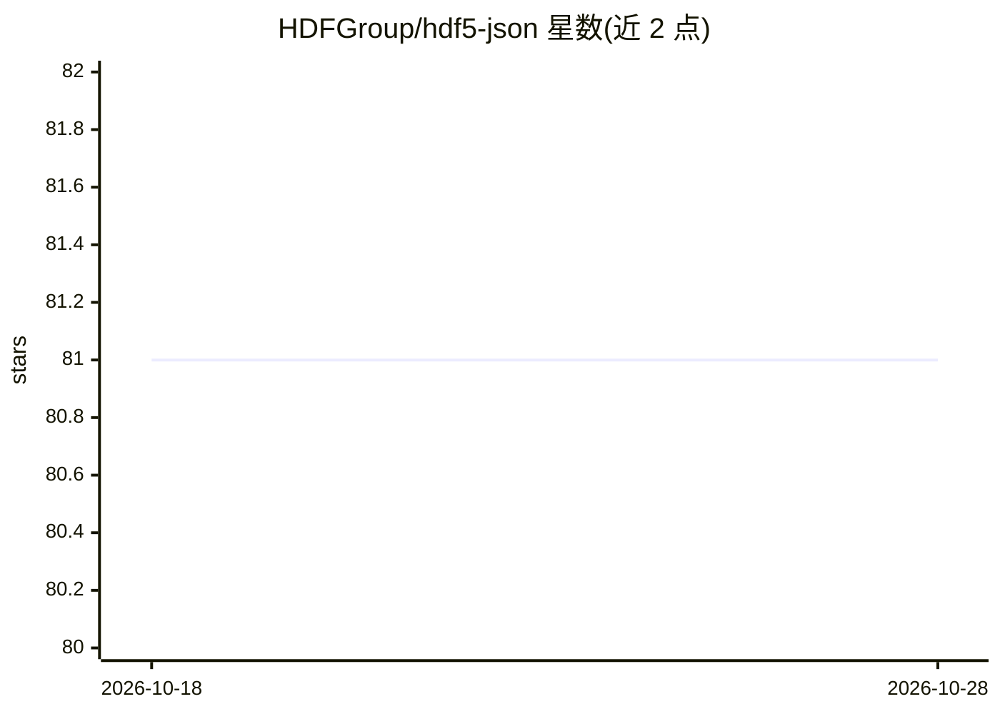

# HDFGroup/hdf5-json

⭐ 81 · Python · NOASSERTION · 推送 2026-10-02 · [GitHub](https://github.com/HDFGroup/hdf5-json) · [官网](https://support.hdfgroup.org/documentation/hdf5-json/latest/) · 组织维护

**HDF5 与 JSON 双向转换的规范与 Python 工具包**

由 HDF Group 维护的项目，提供以 BNF 文法与 JSON Schema 定义的 HDF5-JSON 表示规范，以及一个 Python 包：CLI 工具可将任意 HDF5 文件转换为 JSON，或按该规范从 JSON 文件转回 HDF5；包也可被任何需要在 HDF5 对象与 JSON 序列化之间转换的 Python 应用使用。该包被 HDF Server（HSDS，面向 HDF5 的 RESTful Web 服务）与 HDF Product Designer 使用。文档托管于 readthedocs。

## 筛选速览

| 维度 | 判定 | 备注 |
|---|---|---|
| AI 角色 | `ai-ecosystem` | LLM/agent 周边工具 |
| 许可风险 | `none` | NOASSERTION |
| 部署形态 | `None` |  |
| 模型依赖 | — | README 未给出锁定关系 |
| 硬件要求 | — | 无带数字的原话,不猜 |
| 安装摩擦 | `low` | 无编译、无系统依赖或容器化 |
| 成熟度 | — | 结构信号不足 |

## 能力要点

- BNF 文法与 JSON Schema 定义 HDF5-JSON 表示规范
- CLI 可在 HDF5 文件与 JSON 之间双向转换
- 供 Python 应用做 HDF5 对象与 JSON 序列化互转
- 被 HSDS（HDF Server）与 HDF Product Designer 使用

## 适用场景

- 把 HDF5 科学数据文件转为 JSON 便于 Web 服务处理
- Python 应用中在 HDF5 对象与 JSON 之间转换
- 按规范生成或校验 HDF5 的 JSON 表示

## 场景标签

 · 领域:数据格式/科学计算工具

## 证据(README 行号)

> L12: This repository contains a specification (as BNF grammar and JSON Schema), and a
> L13: package for working with HDF5 content in JSON. The package CLI utilities can be
> L14: used to convert any HDF5 file to JSON or from a JSON file (using the

## 星数曲线

2026-10-18 81 → 2026-10-28 81（+0）

---
*卡片 v1 · prompt 1.4 · 生成 2026-10-24 · 置信度 mid · 依据 README sha `96eedef821f6` · [字段定义](../../DATASET.md)*
