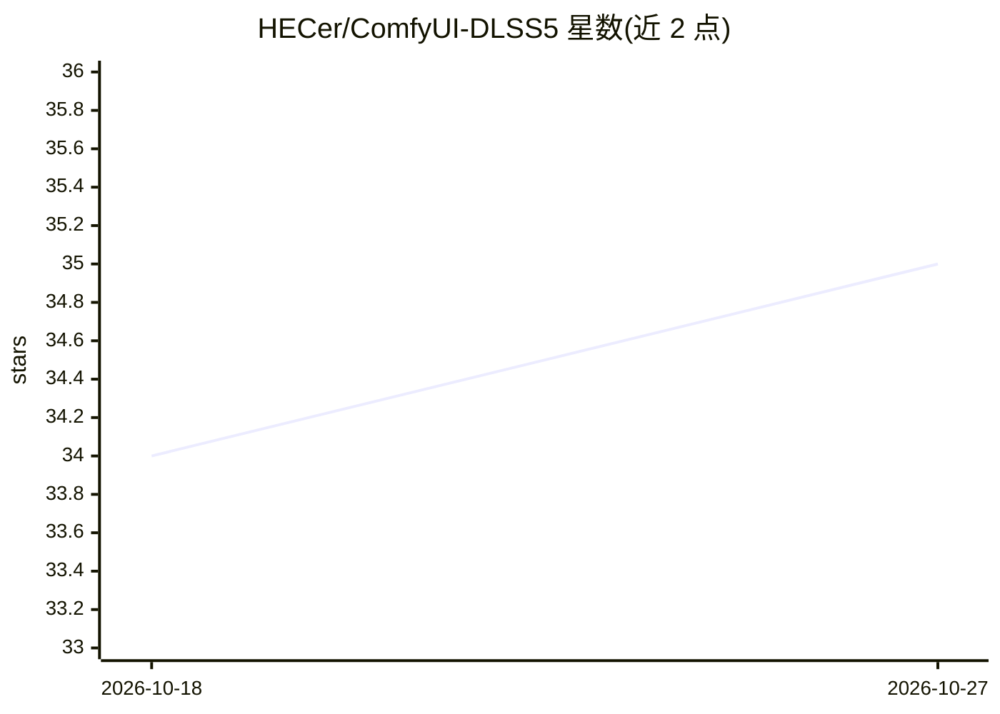

# HECer/ComfyUI-DLSS5

⭐ 35 · Python · GPL-3.0 · 推送 2026-10-25 · [GitHub](https://github.com/HECer/ComfyUI-DLSS5) · [官网](https://registry.comfy.org/publishers/hecer/nodes/experimental-dlss-neural-rendering) · 个人维护

**Windows 版 ComfyUI 节点：NVIDIA DLSS 超分与实验性神经渲染**

非官方的 Windows 专用 ComfyUI 扩展，将图像/视频批次经 VapourSynth 与 D3D12 桥接封装接入 NVIDIA DLSS，提供 2x–4x 超分、实验性神经渲染与可选帧生成。深度与运动引导由 Depth Anything V2、VDA-S、RAFT 等模型从像素估计，游戏引擎的几何/材质缓冲无法从普通图像恢复。要求 RTX GPU、16GB 内存，通过 ComfyUI Manager 或 Git LFS 克隆安装，含原生 DLL 运行时。项目自述为实验性 alpha。

## 筛选速览

| 维度 | 判定 | 备注 |
|---|---|---|
| AI 角色 | `ai-native` | 本体是模型或模型工具 |
| 许可风险 | `viral` | GPL-3.0 |
| 部署形态 | `None` |  |
| 模型依赖 | — | README 未给出锁定关系 |
| 硬件要求 | — | 无带数字的原话,不猜 |
| 安装摩擦 | `medium` | 含编译或系统依赖之一 |
| 成熟度 | `idea` | |

## 能力要点

- DLSS 超分 2x/3x/4x 与实验性神经渲染、可选帧生成（24→48）
- 深度/运动引导模型：DA-V2、VDA-S、RAFT、可选 YOLO26 与 FlashDepth
- 持久全序列与有界 overlap-add 两种视频处理模式
- 6 个预设工作流与运行时状态诊断节点，pytest 测试套件

## 适用场景

- 在 ComfyUI 中对图片或视频做 DLSS 超分辨率
- 视频时序一致深度引导的神经渲染处理
- 通过 Easy 单节点快速上手或插帧到 48 FPS

## 场景标签

`图像视频处理` · 领域:感知与多模态

## 证据(README 行号)

> L7: An unofficial Windows-only ComfyUI extension for NVIDIA DLSS Super Resolution,
> L61: - DLSS Super Resolution at 2x, 3x, or 4x.
> L182: |**Depth Anything V2 Guide**|Pixel-estimated depth with optional temporal normalization|

## 星数曲线

2026-10-18 34 → 2026-10-27 35（+1）

---
*卡片 v1 · prompt 1.4 · 生成 2026-10-25 · 置信度 high · 依据 README sha `3adfc13a3871` · [字段定义](../../DATASET.md)*
