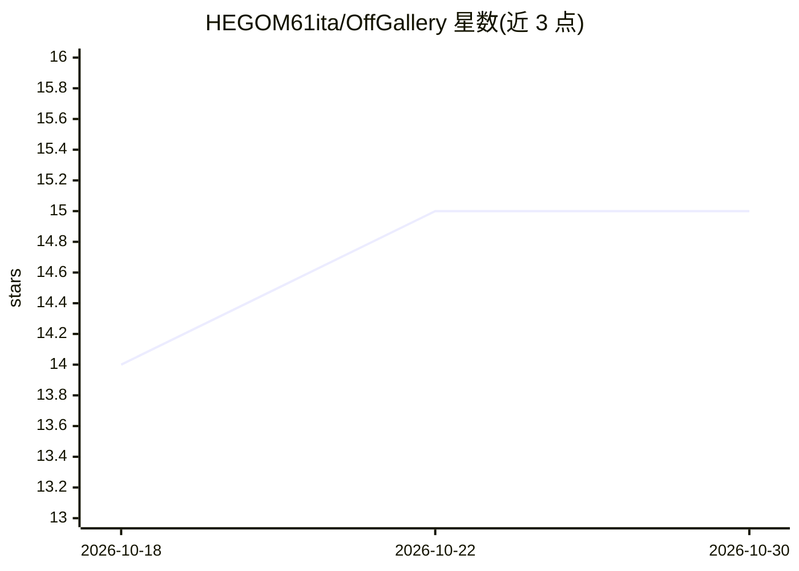

# HEGOM61ita/OffGallery

⭐ 15 · Python · AGPL-3.0 · 推送 2026-09-22 · [GitHub](https://github.com/HEGOM61ita/OffGallery) · 个人维护 · 中文 README

**摄影师的本地 AI 照片编目工具：离线打标、元数据与语义检索**

面向摄影师的桌面照片编目系统，全部 AI 模型本地运行、数据不出本机。核心能力：基于 SigLIP 的多语言语义搜索（自然语言查询 22000+ 张图仍可交互、可中断）、25+ RAW 格式支持、CLIP/DINOv2/BioCLIP2/LLM Vision 多模型分析、美学评分（0-10）、约 45 万物种识别、离线地理层级标注。LLM 后端可选 Ollama 或 LM Studio（插件自动发现、免重启切换）。与 Lightroom 通过 .lrcat 导入和 XMP 双向同步，兼容 Darktable/Capture One 等 XMP 标准软件。GUI、LLM 输出、标签查询三处语言独立配置（6 种语言），翻译用离线 Argostranslate。限制：首次启动需联网下载约 6.7 GB 模型，磁盘最少 14 GB；GPU 可选（NVIDIA/CUDA 或 Apple Silicon Metal），CPU 也可运行但较慢。

## 筛选速览

| 维度 | 判定 | 备注 |
|---|---|---|
| AI 角色 | `ai-native` | 本体是模型或模型工具 |
| 许可风险 | `viral` | AGPL-3.0 |
| 部署形态 | `desktop` | 安装包/桌面程序 |
| 模型依赖 | local-ok | 支持本地模型 |
| 硬件要求 | — | 无带数字的原话,不猜 |
| 安装摩擦 | `medium` | 含编译或系统依赖之一 |
| 成熟度 | — | 结构信号不足 |

## 能力要点

- SigLIP 多语言语义搜索，自然语言直接查询无需翻译
- Lightroom .lrcat 导入与 XMP 双向同步，兼容 Darktable/Capture One 等
- 多模型本地分析：CLIP/DINOv2/BioCLIP2/LLM Vision，逐模型分派 GPU/CPU
- Windows/Linux 图形化一键安装器（含 Miniconda、模型、可选 Ollama）

## 适用场景

- 离线给数万张 RAW 照片自动生成标签、描述与标题
- 用自然语言（如"山间日落"）在本地照片库中检索
- 与 Lightroom/Darktable 工作流互通，回写评分与元数据
- 识别照片中的生物物种并自动补充地理层级信息

## 场景标签

`语义搜索` · 领域:知识与检索

## 证据(README 行号)

> L18:  Analisi semantica ed estetica delle tue foto con AI locale. Zero cloud. Zero compromessi.
> L54: |**100% Offline**|Nessun dato lascia mai il tuo computer. Tutti i modelli AI girano localmente|
> L90: |**Analisi AI**|CLIP · DINOv2 · BioCLIP2 · LLM Vision · Score Estetico · Score Tecnico · Geotag|

## 星数曲线

2026-10-18 14 → 2026-10-30 15（+1）

---
*卡片 v1 · prompt 1.4 · 生成 2026-10-30 · 置信度 high · 依据 README sha `8d35ffc8516f` · [字段定义](../../DATASET.md)*
