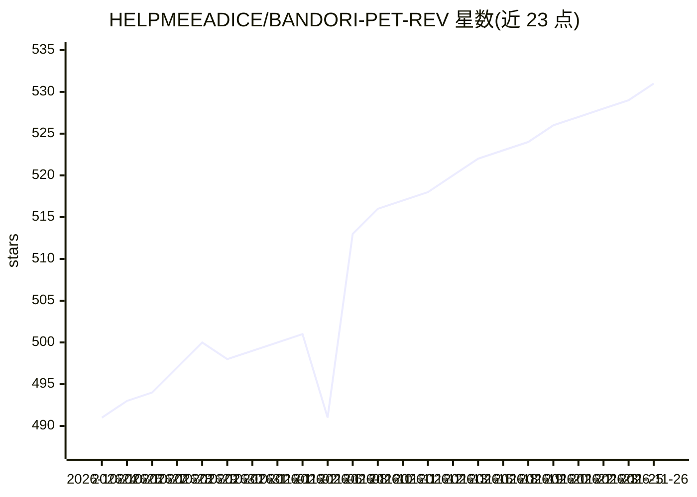

# HELPMEEADICE/BANDORI-PET-REV

⭐ 531 · Python · GPL-3.0 · 推送 2026-11-24 · [GitHub](https://github.com/HELPMEEADICE/BANDORI-PET-REV) · 个人维护 · 中文 README

**基于 Live2D 的 BanG Dream! 桌面宠物，带 LLM 角色扮演对话**

BandoriPet 是基于 Live2D Cubism SDK 与 PySide6 的开源桌面宠物项目，收录 12 个乐团 51+ 位 BanG Dream! 角色与 305+ 套服装，渲染层由 Rust + wgpu 的原生后端（Neocari）经共享内存与主程序通信。AI 相关功能包括：接入大语言模型的角色扮演（每角色专属 System Prompt、好感度记忆系统）、Qwen3TTS 语音合成与口型同步、faster-whisper 本地语音识别、MCP 协议与 Computer Use 工具扩展。安装需 Python 3.10+、Rust 构建原生后端并另行下载约 900MB 模型包，代码以 GPLv3 开源，角色资源版权归原版权方。

## 筛选速览

| 维度 | 判定 | 备注 |
|---|---|---|
| AI 角色 | `ai-enhanced` | 去掉 AI 部分产品仍成立 |
| 许可风险 | `viral` | GPL-3.0 |
| 部署形态 | `desktop` | 安装包/桌面程序 |
| 模型依赖 | — | README 未给出锁定关系 |
| 硬件要求 | — | 无带数字的原话,不猜 |
| 安装摩擦 | `medium` | 含编译或系统依赖之一 |
| 成熟度 | — | 结构信号不足 |

## 能力要点

- 51+ 位角色与 305+ 套服装的 Live2D 桌宠，另支持 VRM 3D 与像素形态
- LLM 角色扮演配好感度/信任/记忆系统与聊天命令
- Qwen3TTS 语音合成口型同步 + faster-whisper 本地语音输入
- MCP 协议与 Computer Use 扩展（文件系统、鼠标键盘操控）

## 适用场景

- 在桌面上饲养 BanG Dream! 角色并与她对话
- 给角色接入本地 TTS/ASR 实现语音交互
- 通过 MCP 让桌宠角色调用本地工具
- 多角色同屏搭自己的小剧场

## 场景标签

`聊天机器人` · 领域:对话与助手

## 证据(README 行号)

> L21: BandoriPet 是一个基于 Live2D Cubism SDK 和 PySide6 的开源桌面宠物项目，支持 **51+ 位** BanG Dream! 角色、**305+ 套**服装，让你的桌面一秒变成 CiRCLE 排练
> L31: - 💬 **LLM 角色扮演 + 好感度记忆系统** — 接入大语言模型，每个角色都有专属 System Prompt，支持中日英多语言 + 动作标签。交互越多角色越了解你，好感度影响情绪和回复风格，支持人设方案保存/切换。

## 星数曲线

2026-10-24 491 → 2026-11-26 531（+40）

---
*卡片 v1 · prompt 1.4 · 生成 2026-11-25 · 置信度 high · 依据 README sha `4188e3eb7f82` · [字段定义](../../DATASET.md)*
