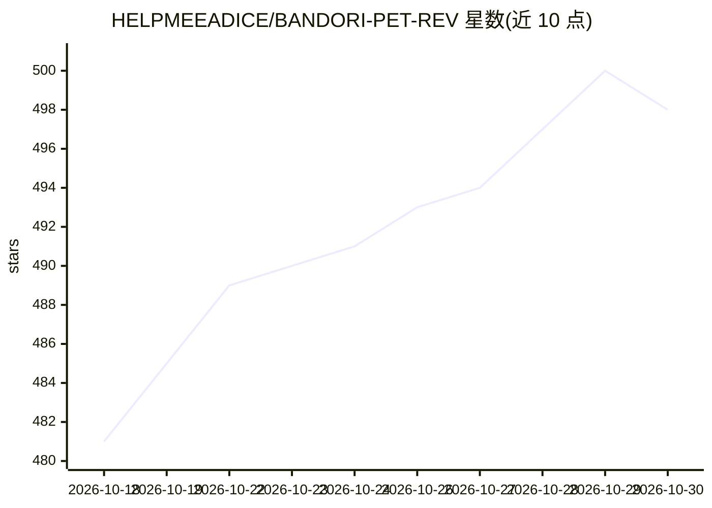

# HELPMEEADICE/BANDORI-PET-REV

⭐ 498 · Python · GPL-3.0 · 推送 2026-10-29 · [GitHub](https://github.com/HELPMEEADICE/BANDORI-PET-REV) · 个人维护 · 中文 README

**把 BanG Dream! 角色养在桌面的 Live2D 桌面宠物，带 LLM 对话**

基于 Live2D Cubism SDK 与 PySide6 的开源桌面宠物，收录 12 个乐团共 51+ 位 BanG Dream! 角色、305+ 套服装，渲染核心为自研 LuaJIT 实现的 Live2D-v2-Lua。AI 功能包括：多后端 LLM 角色扮演对话（角色专属 System Prompt、好感度/记忆系统）、Qwen3TTS 语音合成与口型同步、faster-whisper 本地语音输入、MCP 文件系统与计算机操控扩展。支持多角色同屏、聊天软件 Webhook 接入，提供 Windows/macOS 安装包与源码运行两种途径。

## 筛选速览

| 维度 | 判定 | 备注 |
|---|---|---|
| AI 角色 | `ai-enhanced` | 去掉 AI 部分产品仍成立 |
| 许可风险 | `viral` | GPL-3.0 |
| 部署形态 | `desktop` | 安装包/桌面程序 |
| 模型依赖 | — | README 未给出锁定关系 |
| 硬件要求 | — | 无带数字的原话,不猜 |
| 安装摩擦 | `medium` | 含编译或系统依赖之一 |
| 成熟度 | — | 结构信号不足 |

## 能力要点

- 51+ 位角色、305+ 套服装，Live2D 与像素风两种形态
- LLM 角色扮演 + 好感度/信任/熟悉度记忆系统，40+ 位角色 Prompt
- TTS 语音合成（口型同步）与 faster-whisper 语音输入
- MCP + Computer Use 扩展文件系统操作与浏览器/鼠标键盘控制

## 适用场景

- 在桌面上与 BanG Dream! 角色 Live2D 形象互动聊天
- 通过语音输入和角色对话并听到角色语音回应
- 让角色通过 MCP 调用本地文件与计算机操作工具

## 场景标签

`聊天机器人` `语音合成` · 领域:对话与助手

## 证据(README 行号)

> L18: BandoriPet 是一个基于 Live2D Cubism SDK 和 PySide6 的开源桌面宠物项目，支持 **51+ 位** BanG Dream! 角色、**305+ 套**服装，让你的桌面一秒变成 CiRCLE 排练
> L27: - 💬 **LLM 角色扮演 + 好感度记忆系统** — 接入大语言模型，每个角色都有专属 System Prompt，支持中日英多语言 + 动作标签。交互越多角色越了解你，好感度影响情绪和回复风格，支持人设方案保存/切换。
> L284: |**Live2D-v2-Lua**|自研 LuaJIT Live2D v2 渲染核心（替代 live2d-py，性能提升 6x+）|

## 星数曲线

2026-10-18 481 → 2026-10-30 498（+17）

---
*卡片 v1 · prompt 1.4 · 生成 2026-10-21 · 置信度 high · 依据 README sha `3e7581c36f0d` · [字段定义](../../DATASET.md)*
