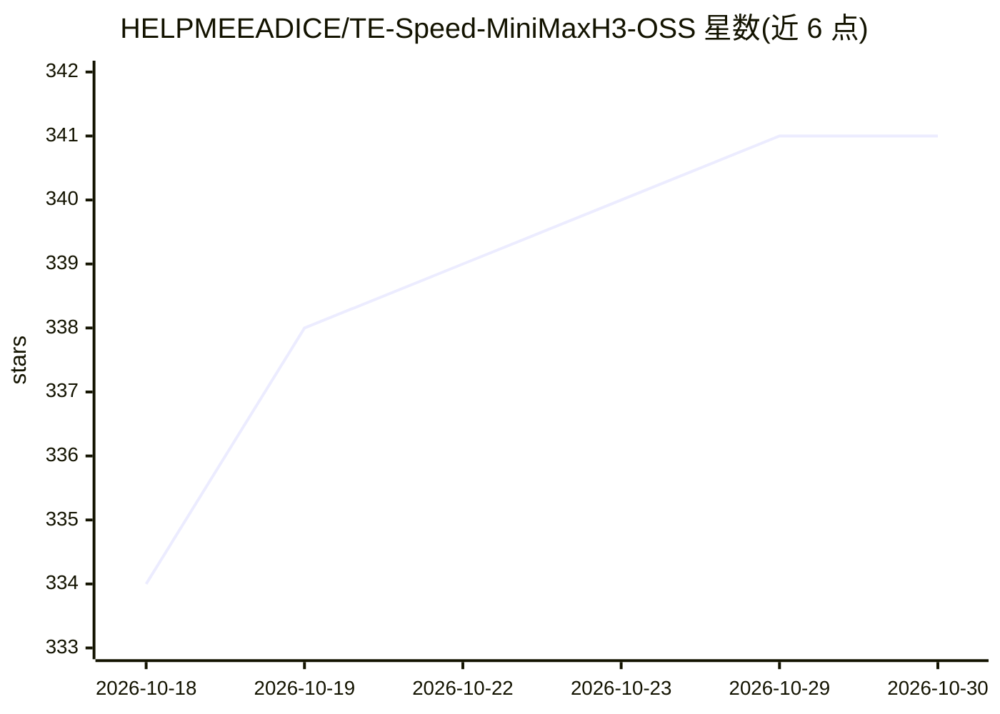

# HELPMEEADICE/TE-Speed-MiniMaxH3-OSS

⭐ 341 · Python · LGPL-3.0 · 推送 2026-08-03 · [GitHub](https://github.com/HELPMEEADICE/TE-Speed-MiniMaxH3-OSS) · 个人维护 · 中文 README

**ComfyUI 中 MiniMax H3 视频模型的残差缓存加速节点**

面向 ComfyUI 用户的加速插件：通过 patch_model.py 给 MiniMax H3 模型文件打两处最小钩子补丁（自动备份、可 --revert 回退），之后以 TESpeedMiniMaxH3(OSS) 节点接入 UNETLoader 与 BasicScheduler/BasicGuider 之间。机制为接管 50 层 DiT 的块循环：完整步保存残差，缓存步只重算热身块并加残差校正；相邻步 sigma 差、调度窗口与连续缓存步数三条件同时满足才走缓存。参数可调缓存窗口、最大连续缓存步、残差存放设备（gpu/cpu）与尾部块缓存深度。README 称默认参数下参考工作流（30 步、8s 视频）约提速 45%。

## 筛选速览

| 维度 | 判定 | 备注 |
|---|---|---|
| AI 角色 | `ai-ecosystem` | LLM/agent 周边工具 |
| 许可风险 | `viral` | LGPL-3.0 |
| 部署形态 | `None` |  |
| 模型依赖 | — | README 未给出锁定关系 |
| 硬件要求 | — | 无带数字的原话,不猜 |
| 安装摩擦 | `low` | 无编译、无系统依赖或容器化 |
| 成熟度 | — | 结构信号不足 |

## 能力要点

- 接管 50 层 DiT 块循环，残差校正的部分块缓存机制
- patch_model.py 自动定位 ComfyUI 打补丁，支持备份与 --revert 回退
- 缓存窗口、连续缓存步上限、残差存放设备（gpu/cpu）等参数可调
- 控制台打印每次运行的加速百分比统计

## 适用场景

- 在 ComfyUI 中加速 MiniMax H3 视频生成工作流
- 显存紧张时把缓存残差放到 CPU
- 需要回退到官方模型行为时一键还原补丁

## 场景标签

`视频生成` · 领域:内容生成

## 证据(README 行号)

> L5: 1. 把 `TE-Speed-MiniMaxH3-OSS` 文件夹放入 `ComfyUI\custom_nodes`。
> L22: 工作流中把 `UNETLoader` 输出的 model 接入 `TE-Speed-MiniMaxH3 (OSS)` 节点，
> L46: 每个去噪步，插件通过 `("block_loop", 0)` 钩子接管 50 层 DiT 的块循环：

## 星数曲线

2026-10-18 334 → 2026-10-30 341（+7）

---
*卡片 v1 · prompt 1.4 · 生成 2026-10-21 · 置信度 high · 依据 README sha `b8787b2b6eb6` · [字段定义](../../DATASET.md)*
