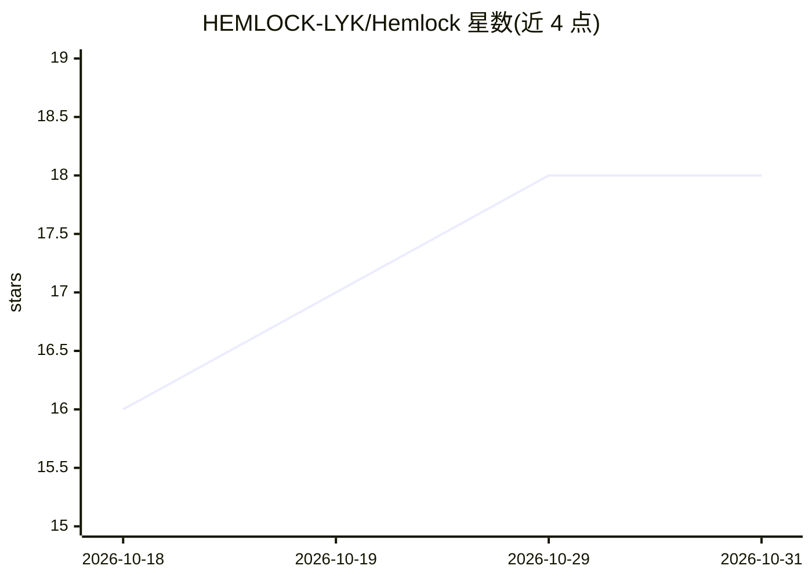

# HEMLOCK-LYK/Hemlock

⭐ 18 · Python · MIT · 推送 2026-10-28 · [GitHub](https://github.com/HEMLOCK-LYK/Hemlock) · 个人维护 · 中文 README

**面向安全测试人员的 AI Agent 渗透测试桌面工具**

基于 Tauri + FastAPI + React 的桌面应用，将 LLM Agent 与 mitmproxy 11 抓包工具链（代理、拦截器、Repeater、Intruder）整合在同一界面。自然语言下达指令后 Agent 自主执行侦察、测试、验证、报告，每个请求进流量记录，漏洞附原始证据并要求人工复核，敏感操作强制确认。支持攻击链画布、长期/项目记忆知识库、FOFA 等 9 引擎信息收集、浏览器自动化与 MCP 工具注入，可接入 OpenAI/DeepSeek/Anthropic/通义/Gemini/Kimi/Ollama 等模型。提供 Windows x64 安装包，开发模式从源码运行，仅限授权测试使用。

## 筛选速览

| 维度 | 判定 | 备注 |
|---|---|---|
| AI 角色 | `ai-native` | 本体是模型或模型工具 |
| 许可风险 | `permissive` | MIT |
| 部署形态 | `desktop` | 安装包/桌面程序 |
| 模型依赖 | locked-api |  |
| 硬件要求 | — | 无带数字的原话,不猜 |
| 安装摩擦 | `low` | 无编译、无系统依赖或容器化 |
| 成熟度 | — | 结构信号不足 |

## 能力要点

- 自然语言驱动 Agent 自主执行侦察→测试→验证→报告
- 抓包代理/拦截器/Repeater/Intruder 与 AI Agent 同应用闭环
- 漏洞附原始请求响应证据，敏感操作强制人工确认
- 多 LLM 接入（OpenAI/DeepSeek/Anthropic/通义/Gemini/Kimi/Ollama 等）

## 适用场景

- 授权渗透测试中用自然语言让 Agent 自主完成测试并复核证据
- Web 安全测试时人工抓包调试与 AI 自动测试并用
- SRC 漏洞挖掘工作流（种子队列→资产确认→单站打穿→报告）

## 场景标签

`网络安全` · 领域:学习与行业

## 证据(README 行号)

> L15: Hemlock 把 **AI Agent 和 Burp 级抓包工具链放进同一个应用**：配好 LLM Key，说一句「帮我测试 https://xxx.com」，Agent 自主完成侦察、测试、验证、报告；每个请求都进抓包记录，每
> L53: |🔍 **AI 自主渗透**|自然语言驱动，侦察 → 测试 → 验证 → 报告自主执行|

## 星数曲线

2026-10-18 16 → 2026-10-31 18（+2）

---
*卡片 v1 · prompt 1.4 · 生成 2026-10-29 · 置信度 high · 依据 README sha `cd94c6cbf2bd` · [字段定义](../../DATASET.md)*
