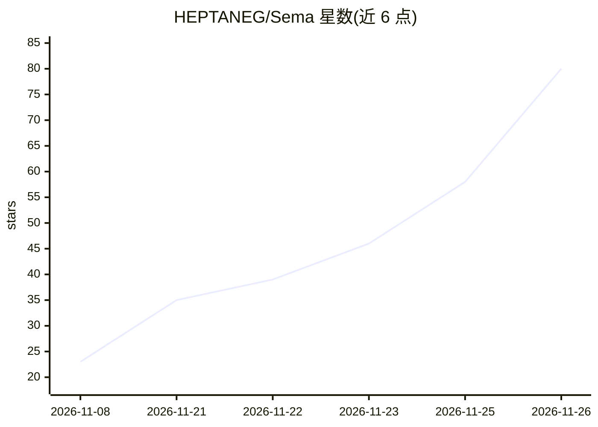

# HEPTANEG/Sema

⭐ 80 · Python · MIT · 推送 2026-11-11 · [GitHub](https://github.com/HEPTANEG/Sema) · 个人维护 · 中文 README

**记忆原生 AI agent：跨会话长期记忆与自主维护**

Windows 优先的实验性 AI agent，核心是自研 Memory Engine：Event Stream 保留原始证据，STM/WM/Focus/LTM 分层管理状态；借鉴推荐系统的 Memory Push 自动激活相关长期上下文，无需模型显式调用检索工具；离线五阶段 ReAct Maintainer 做去重、抽象、情节化等巩固，经确定性 Compiler 校验后原子提交 SQLite。动态上下文预算按交互分配窗口容量。前端为 TypeScript/React/Ink TUI，经 Windows Named Pipe 连接 Python 后端。当前连续性限定在单一 workspace 内。

## 筛选速览

| 维度 | 判定 | 备注 |
|---|---|---|
| AI 角色 | `ai-native` | 本体是模型或模型工具 |
| 许可风险 | `permissive` | MIT |
| 部署形态 | `library` | 以包/库形式分发 |
| 模型依赖 | — | README 未给出锁定关系 |
| 硬件要求 | — | 无带数字的原话,不猜 |
| 安装摩擦 | `low` | 无编译、无系统依赖或容器化 |
| 成熟度 | `idea` | |

## 能力要点

- Memory Push 自动向当前轮注入相关长期记忆，无需显式召回调用
- 离线睡眠式五阶段 LTM Maintainer（去重/抽象/情节/最终校验）
- 动态上下文预算分层分配 STM/WM/Focus/LTM/工具结果
- 原始证据与派生记忆共存，摘要不替代历史

## 适用场景

- 跨会话保持个人上下文连续性的对话 agent
- 无需用户自行管理记忆边界的长期助理
- 研究与审计可追溯的 agent 记忆生命周期

## 场景标签

`Agent 记忆` `AI 助手` · 领域:Agent 开发

## 证据(README 行号)

> L11: Sema is a Windows-first experimental AI agent built around an original Memory
> L55: Sema is not an agent with a memory plugin. It is a memory-native agent whose
> L269: TypeScript / React / Ink TUI --+

## 星数曲线

2026-11-08 23 → 2026-11-26 80（+57）

---
*卡片 v1 · prompt 1.4 · 生成 2026-11-18 · 置信度 mid · 依据 README sha `d95b4665f15c` · [字段定义](../../DATASET.md)*
