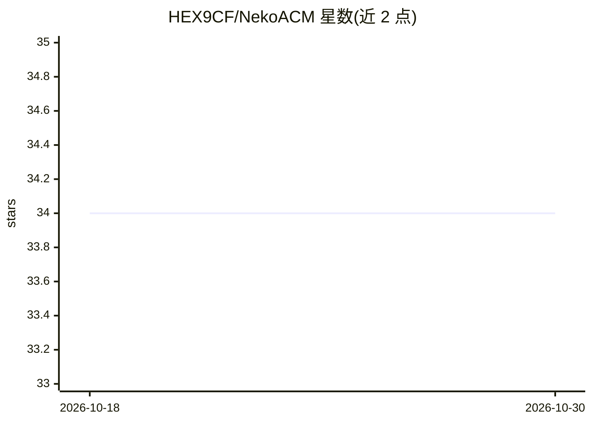

# HEX9CF/NekoACM

⭐ 34 · Go · LGPL-3.0 · 推送 2025-11-22 · [GitHub](https://github.com/HEX9CF/NekoACM) · 个人维护 · 中文 README

**面向 ACM-ICPC 竞赛的大模型工具包：自动出题与题解生成**

基于大模型 API 的 ACM-ICPC 算法竞赛工具包，功能包括题目格式解析（多格式转 JSON）、题目多语言翻译、自动出题、测试数据生成、题解代码生成、AI 编程助手对话、虚拟评测（模拟编译运行预测输出）和算法笑话。可作为独立服务运行（终端/对话/服务器三种模式，HTTP API 默认端口 14515，Bearer token 鉴权），也可作为模块集成到 Online Judge 系统（已集成于 STUOJ）。支持 OpenAI API 标准（含 GLM 等第三方模型）。注意事项声明生成内容不保证正确性，需人工校验。许可为 LGPL-3.0。

## 筛选速览

| 维度 | 判定 | 备注 |
|---|---|---|
| AI 角色 | `ai-native` | 本体是模型或模型工具 |
| 许可风险 | `viral` | LGPL-3.0 |
| 部署形态 | `None` |  |
| 模型依赖 | — | README 未给出锁定关系 |
| 硬件要求 | — | 无带数字的原话,不猜 |
| 安装摩擦 | `low` | 无编译、无系统依赖或容器化 |
| 成熟度 | — | 结构信号不足 |

## 能力要点

- 题目解析/翻译/出题/测试数据/题解生成覆盖竞赛题目生产链路
- 虚拟评测：基于大模型模拟编译运行并预测评测结果
- 支持 OpenAI API 标准及其第三方模型（如 GLM 系列）
- 服务器模式提供 HTTP API，可集成到 OJ 系统（STUJ 已集成）

## 适用场景

- OJ 维护者自动生成新题、测试数据与题解
- 把中文算法题目翻译为多语言做国际化
- 竞赛选手通过 AI 编程助手获得数据结构与算法指导
- 无真实评测环境时用虚拟评测预估提交结果

## 场景标签

`代码生成` `AI 助手` · 领域:编码与开发

## 证据(README 行号)

> L7: 基于人工智能大模型的 ACM-ICPC 神经网络引擎工具包，提供自动出题、生成测试数据和题解代码、题目格式解析、题目国际化翻译、虚拟评测机、AI 编程助手等功能。可以作为一个单独的服务运行，也可以作为模块集成到 Online Jud
> L11: - **AI 编程助手**：一个为 ACM-ICPC 算法竞赛和 OI 信息学竞赛选手提供帮助的 AI 编程助手，提供数据结构与算法相关的指导。
> L32: - OpenAI: 包括 GPT 系列，和支持该标准的第三方模型（如 GLM 系列等）

## 星数曲线

2026-10-18 34 → 2026-10-30 34（+0）

---
*卡片 v1 · prompt 1.4 · 生成 2026-10-26 · 置信度 high · 依据 README sha `0b3fbe026a82` · [字段定义](../../DATASET.md)*
