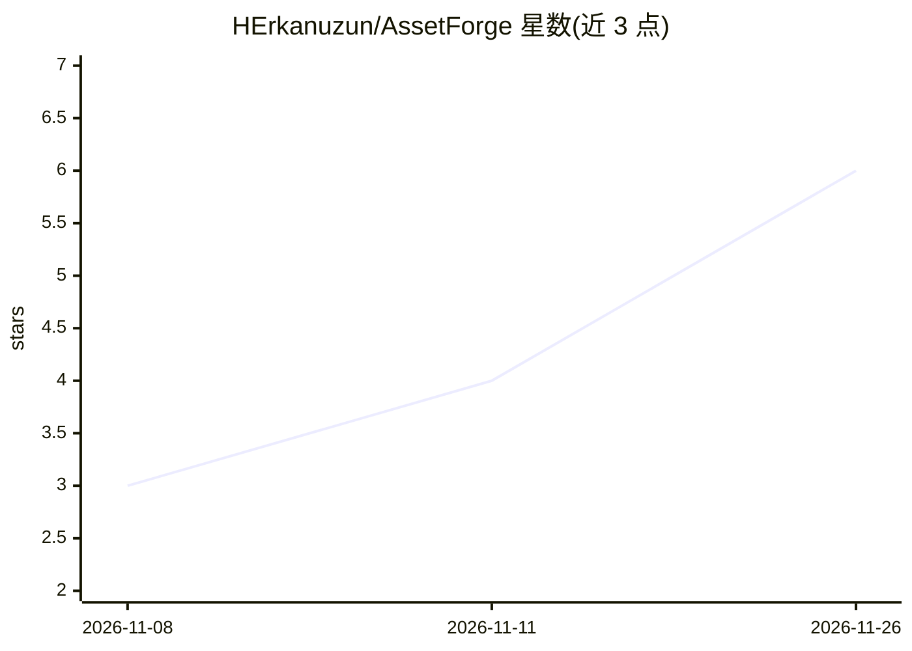

# HErkanuzun/AssetForge

⭐ 6 · TypeScript · AGPL-3.0 · 推送 2026-11-24 · [GitHub](https://github.com/HErkanuzun/AssetForge) · [官网](https://github.com/HErkanuzun/AssetForge/releases/latest) · 个人维护 · 中文 README

**把文本描述变成 UE5 游戏资产的桌面 AI 流水线**

AssetForge 是面向 Windows 的开源桌面应用，把一段文字需求经节点式流水线转为 Unreal Engine 5 可用的资产：Meshy 生成 3D 网格与贴图、NVIDIA Kimodo（本地 CUDA）生成动画片段、ElevenLabs 生成音效、ComfyUI 生成图像/纹理/音频、Blender 无头清理与 LOD，最后经 UE5 Python 远程执行自动导入并构建 Blend Spaces、Montages、Motion Matching 数据库。面向独立开发者、技术美术与学生。带 AI 导演对话、质检重试循环、Producer Agent（20+ 工具）与 MCP server/client。当前界面为土耳其语，版本 0.6.0 alpha。

## 筛选速览

| 维度 | 判定 | 备注 |
|---|---|---|
| AI 角色 | `ai-native` | 本体是模型或模型工具 |
| 许可风险 | `dual` | AGPL-3.0 |
| 部署形态 | `desktop` | 安装包/桌面程序 |
| 模型依赖 | local-ok | 支持本地模型 |
| 硬件要求 | — | 无带数字的原话,不猜 |
| 安装摩擦 | `medium` | 含编译或系统依赖之一 |
| 成熟度 | `idea` | |

## 能力要点

- 文本到 3D/动画/音效的节点式流水线，一键导入 UE5 并自动构建动画系统
- Motion Matching 全套：Pose Search Schema 与 Database 自动填充，26-clip dance card
- MCP server 暴露于 127.0.0.1:9560，可被 Claude Code/Claude Desktop 等客户端驱动
- 本地检查动画（滑步、抖动、速度）与音频（静音、削波、循环接缝），低分自动重写提示词重跑

## 适用场景

- 输入一句话描述批量生成角色、载具、道具的完整资产包
- 为角色自动生成含 Motion Matching 的移动动画系统
- 从 Excel/CSV 清单批量生产项目资产
- 团队通过浏览器在同一 PC 上协作编辑资产流水线

## 场景标签

`图像生成` `工作流自动化` · 领域:效率与自动化

## 证据(README 行号)

> L22: AssetForge is a free and open-source **desktop app for Windows that turns a short text brief into production-ready 
> L26: |Prompt engine, art direction, vision QA|Claude, or any OpenAI-compatible / local LLM (Ollama, LM Studio, vLLM, Ope
> L51: - **"Producer" AI agent (Ctrl+J).** An in-app assistant with 20+ tools: write assets, run pipelines, review preview

## 星数曲线

2026-11-08 3 → 2026-11-26 6（+3）

---
*卡片 v1 · prompt 1.4 · 生成 2026-11-21 · 置信度 high · 依据 README sha `9e3a4d6ba499` · [字段定义](../../DATASET.md)*
