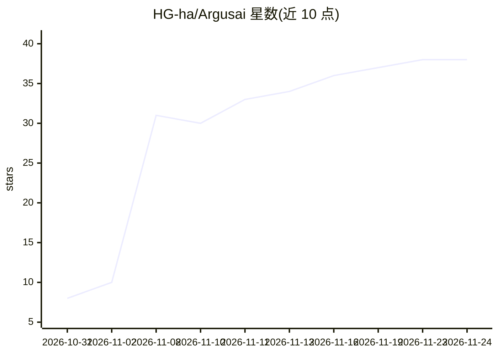

# HG-ha/Argusai

⭐ 40 · Python · GPL-3.0 · 推送 2026-11-18 · [GitHub](https://github.com/HG-ha/Argusai) · [官网](https://argusai.sh) · 组织维护 · 中文 README

**面向安全人员的 Agent 原生本地安全工作台**

由达瓦科技开源的跨平台安全工作台，把 AI Agent、浏览器、代理流量、扫描、逆向与证据管理放在同一本地工作区。用户把代码、HAR、JS 样本连同授权范围交给 Agent，由其组织工具推进分析、保存证据并复核修复。模型可使用自配置端点，也可经 ACP 接入本机已安装的 Codex、Cursor、Claude Code。GUI 与 CLI 共用内核，支持数十小时级单轮自主执行、持久小队、四类触发调度与 QQ/飞书/Telegram 等通讯渠道；逆向按需连接 JADX、Ghidra、Frida 等外部工具，限授权范围内使用。

## 筛选速览

| 维度 | 判定 | 备注 |
|---|---|---|
| AI 角色 | `ai-native` | 本体是模型或模型工具 |
| 许可风险 | `viral` | GPL-3.0 |
| 部署形态 | `None` |  |
| 模型依赖 | — | README 未给出锁定关系 |
| 硬件要求 | — | 无带数字的原话,不猜 |
| 安装摩擦 | `low` | 无编译、无系统依赖或容器化 |
| 成熟度 | — | 结构信号不足 |

## 能力要点

- GUI 与 CLI 共用内核，预编译包覆盖 Windows/Linux x64/ARM64 与 Apple Silicon
- 经 ACP 接入本机 Codex、Cursor、Claude Code 等外部 Agent 并通过工具桥调用工作台能力
- 数十小时级单轮自主执行与间隔/Cron/Webhook/文件变化四类触发调度
- 支持 JS/WASM/APK/IPA/PE/ELF/HAR 的统一逆向工作台与证据归档

## 适用场景

- 在授权范围内审查 AI 生成代码与应用中的漏洞并复核修复
- 持续巡检资产暴露面变化并按基线主动报告
- 通过手机 QQ/飞书/Telegram 等渠道下达任务、查看进度与接收报告
- 在内网防护、应用验证与攻击溯源中组织证据与交付材料

## 场景标签

`网络安全` · 领域:学习与行业

## 证据(README 行号)

> L22: ArgusAI 是由达瓦科技开源的 Agent 原生安全工作台，用于代码审查、Web 安全验证和逆向分析。它把 AI 助手、浏览器、代理流量、扫描任务和证据放在同一个本地工作区，帮助安全研究人员、开发者与防守团队检查 AI 生成代
> L206: **模型端点与本地 Agent 都能驱动工作。** 可以使用自己配置的 AI 端点，也可以通过 ACP 接入已在本机安装、登录的 Codex、Cursor、Claude Code 等 Agent，让它们在 ArgusAI 内工作

## 星数曲线

2026-10-31 8 → 2026-11-24 38（+30）

---
*卡片 v1 · prompt 1.4 · 生成 2026-11-18 · 置信度 high · 依据 README sha `d7b412eb0e26` · [字段定义](../../DATASET.md)*
