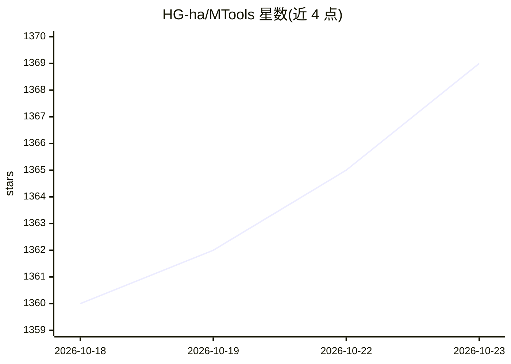

# HG-ha/MTools

⭐ 1,369 · Python · MIT · 推送 2026-10-09 · [GitHub](https://github.com/HG-ha/MTools) · 个人维护 · 中文 README

**跨平台桌面多功能工具集，含 AI 工具与本地 MCP 服务**

基于 Python/Flet 的桌面工具集，集成图片处理、音视频编辑、AI 智能工具与开发辅助功能，提供 Windows/macOS/Linux 预编译版本并支持 GPU 加速。AI 部分包括：通过 sherpa-onnx 本地集成 SenseVoice/Paraformer 语音识别（无需 funasr 包）、参考 PPOCR_v5/HivisionIDPhotos/video-subtitle-remover 实现的 OCR、证件照、去水印等功能，并可通过 OpenAI 兼容 API 接入外部模型。另内置 Streamable HTTP MCP 服务，供 OpenClaw、Hermes、Cursor 等 Agent 调用本地工具能力。macOS/Linux 为实验性支持。

## 筛选速览

| 维度 | 判定 | 备注 |
|---|---|---|
| AI 角色 | `ai-enhanced` | 去掉 AI 部分产品仍成立 |
| 许可风险 | `permissive` | MIT |
| 部署形态 | `None` |  |
| 模型依赖 | — | README 未给出锁定关系 |
| 硬件要求 | — | 无带数字的原话,不猜 |
| 安装摩擦 | `medium` | 含编译或系统依赖之一 |
| 成熟度 | `idea` | |

## 能力要点

- sherpa-onnx 本地集成 SenseVoice/Paraformer 语音识别，无需 funasr 包
- 内置 Streamable HTTP MCP 服务，供 OpenClaw/Hermes/Cursor 调用
- Windows/macOS/Linux 预编译版本，支持 DirectML/CoreML/CUDA 加速
- 提供普通/CUDA/CUDA_FULL 三种编译版本选择

## 适用场景

- 在桌面端一站式处理图片、音视频与文本
- 离线运行语音识别、OCR、证件照等 AI 功能
- 把本地工具能力通过 MCP 暴露给 Agent 使用

## 场景标签

`语音识别` `OCR` `图像视频处理` · 领域:感知与多模态

## 证据(README 行号)

> L12: 集成图片处理、音视频编辑、AI 智能工具、开发辅助等功能，支持跨平台GPU加速
> L110: 语音识别已通过 **sherpa-onnx** 集成 SenseVoice / Paraformer（完全本地，无需 `funasr` Python 包）。
> L103: MTools 内置 **Streamable HTTP MCP**，可在应用内开启后供 OpenClaw、Hermes、Cursor 等调用本地工具能力。

## 星数曲线

2026-10-18 1,360 → 2026-10-23 1,369（+9）

---
*卡片 v1 · prompt 1.4 · 生成 2026-10-21 · 置信度 high · 依据 README sha `e5a43e8ddc0c` · [字段定义](../../DATASET.md)*
