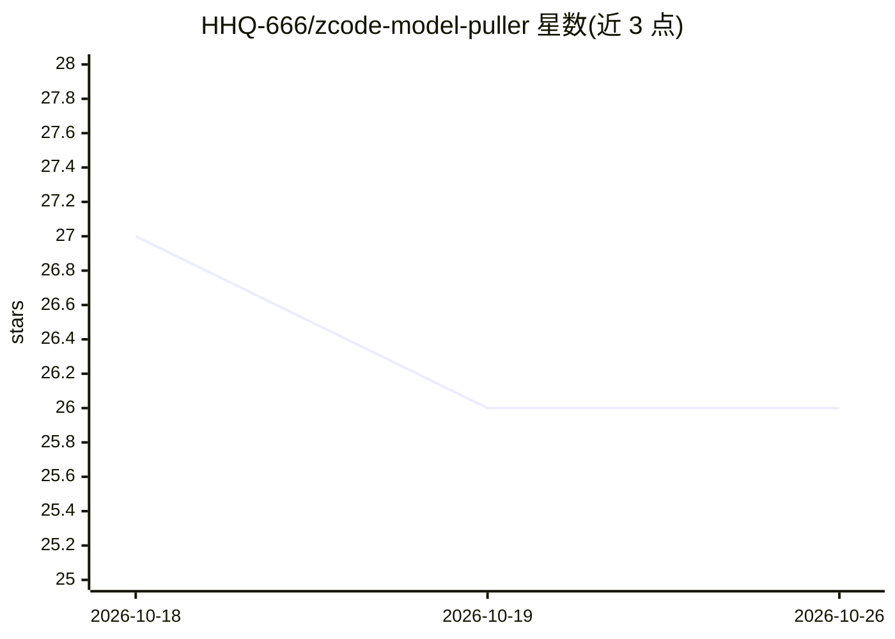

# HHQ-666/zcode-model-puller

⭐ 26 · Python · MIT · 推送 2026-10-14 · [GitHub](https://github.com/HHQ-666/zcode-model-puller) · [官网](https://zcode.z.ai) · 个人维护 · 中文 README

**为 ZCode 客户端注入「自动拉取模型」按钮的 macOS 工具**

面向 ZCode（AI 编程桌面客户端）macOS 用户的模型列表同步工具：通过 @electron/asar 解包重构客户端应用包，在设置界面原「添加模型」按钮旁注入「自动拉取模型」按钮，批量探测自定义供应商（OpenAI 兼容接口、OneAPI/NewAPI、阿里百炼、DeepSeek、Ollama 等）的可用模型并写入 provider_config.json；已添加模型自动取消勾选、新模型默认全选。也可不改界面直接用 Python CLI 同步。首次注入自动备份原版 app.asar，提供卸载还原脚本与 LaunchAgent 更新守护（客户端升级后自动重装）。适配 ZCode 3.12+。

## 筛选速览

| 维度 | 判定 | 备注 |
|---|---|---|
| AI 角色 | `ai-ecosystem` | LLM/agent 周边工具 |
| 许可风险 | `permissive` | MIT |
| 部署形态 | `None` |  |
| 模型依赖 | — | README 未给出锁定关系 |
| 硬件要求 | — | 无带数字的原话,不猜 |
| 安装摩擦 | `low` | 无编译、无系统依赖或容器化 |
| 成熟度 | — | 结构信号不足 |

## 能力要点

- 解包 app.asar 注入原生样式按钮，兼容浅色/深色主题
- 智能比对已添加/新模型并批量同步写入配置
- 首次注入自动冷备份 app.asar，提供一键卸载还原
- macOS LaunchAgent 更新守护，客户端升级后自动重装

## 适用场景

- 我有几十上百个模型的自定义供应商，不想逐个手动输入模型 ID
- ZCode 升级后自动恢复注入的自动拉取按钮
- 不修改客户端界面，仅在终端批量同步供应商模型列表

## 场景标签

 · 领域:AI 编程客户端工具

## 证据(README 行号)

> L25: ZCode 是一款强大的 AI 编程桌面客户端，支持配置自定义模型供应商（如 OpenAI 兼容接口、各大中转站、OneAPI、NewAPI、阿里百炼、DeepSeek、Ollama 等）。
> L30: - 既支持在终端中**一键全自动同步**
> L43:  - 点击「确认添加并保存」后，通过安全的 Electron IPC 原生读写配置，并**自动联动官方刷新事件**，新模型卡片即刻展现在列表中，无需手动刷新或切换页面！

## 星数曲线

2026-10-18 27 → 2026-10-26 26（-1）

---
*卡片 v1 · prompt 1.4 · 生成 2026-10-26 · 置信度 high · 依据 README sha `f2c14bbd2f0a` · [字段定义](../../DATASET.md)*
