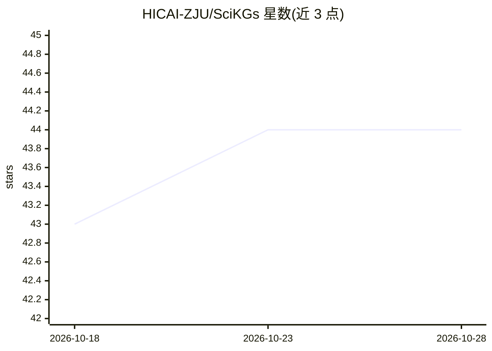

# HICAI-ZJU/SciKGs

⭐ 44 · 推送 2026-01-21 · [GitHub](https://github.com/HICAI-ZJU/SciKGs) · 组织维护

**AI for Science 中科学知识图谱的综述与论文清单**

浙江大学团队维护的科学知识图谱（SciKG）综述配套仓库：围绕生物学、化学、材料科学四类任务（药物研发、组学分析、化学反应、材料设计）组织内容；按 SciKG 生命周期（构建维护、核心功能、与 LLM 协同、挑战与机遇）展开，并以表格形式按年份、任务、构建方式、发表期刊收录各领域 SciKG 论文及代码链接，当前可见部分覆盖 2021–2025 年药物研发方向的条目。

## 筛选速览

| 维度 | 判定 | 备注 |
|---|---|---|
| AI 角色 | `ai-knowledge` | 知识聚合/清单类 |
| 许可风险 | `none` | — |
| 部署形态 | `None` |  |
| 模型依赖 | — | README 未给出锁定关系 |
| 硬件要求 | — | 无带数字的原话,不猜 |
| 安装摩擦 | `low` | 无编译、无系统依赖或容器化 |
| 成熟度 | — | 结构信号不足 |

## 能力要点

- 覆盖药物研发、组学、化学反应、材料设计四大科学任务
- 按 SciKG 生命周期组织综述结构（构建→功能→LLM 协同→挑战）
- 以表格收录论文条目，附 KG 名称、构建方式、发表期刊与代码链接

## 适用场景

- 查找药物研发等领域的知识图谱相关论文与代码
- 了解 SciKG 与 LLM 集成的研究脉络
- 按任务和年份检索已发表的知识图谱工作

## 场景标签

`精选清单` · 领域:学习与行业

## 证据(README 行号)

> L3: Bridging Data and Discovery: A Survey on Knowledge Graphs in AI for Science
> L53: |Year|Title|KG Name|KG Type|Domain|Construction Method|Venue|Paper|Code|

## 星数曲线

2026-10-18 43 → 2026-10-28 44（+1）

---
*卡片 v1 · prompt 1.4 · 生成 2026-10-25 · 置信度 high · 依据 README sha `72e0f7097793` · [字段定义](../../DATASET.md)*
