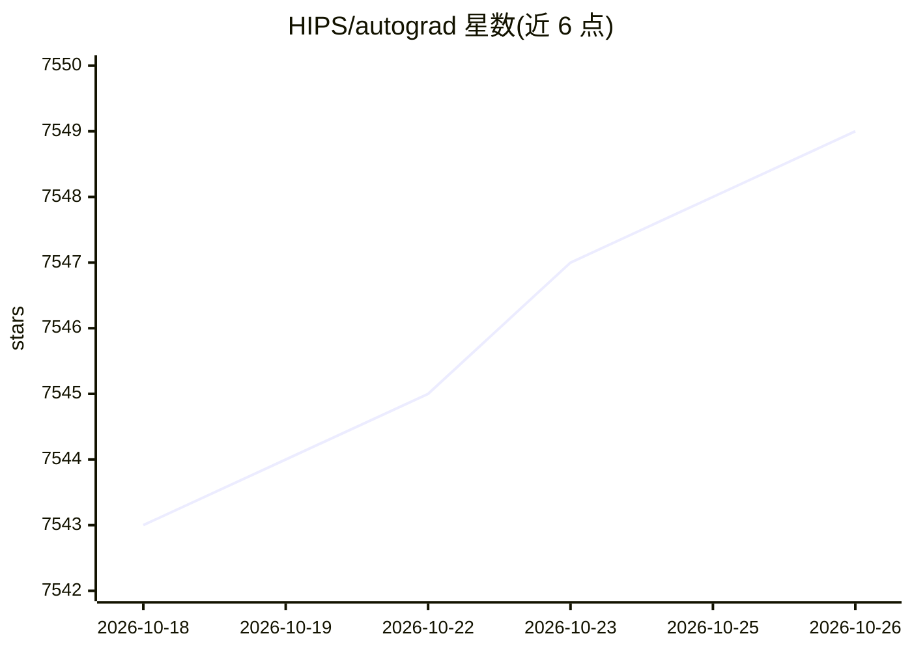

# HIPS/autograd

⭐ 7,549 · Python · MIT · 推送 2026-10-19 · [GitHub](https://github.com/HIPS/autograd) · 组织维护

**对原生 Python/NumPy 代码做自动微分的库，服务于梯度优化**

Autograd 是一个 Python 自动微分库：通过包装 NumPy，直接对原生 Python 和 NumPy 代码求导，支持循环、递归、闭包等语言特性，可对导数继续求导；同时支持反向模式（反向传播）与正向模式微分，二者可任意组合。主要预期用途是基于梯度的优化，并提供从简单神经网络、CNN、RNN、LSTM 到神经图灵机、变分推断、高斯过程回归等端到端示例。以 pip 安装的库形式提供给研究者和开发者使用。

## 筛选速览

| 维度 | 判定 | 备注 |
|---|---|---|
| AI 角色 | `ai-ecosystem` | LLM/agent 周边工具 |
| 许可风险 | `permissive` | MIT |
| 部署形态 | `library` | 以包/库形式分发 |
| 模型依赖 | — | README 未给出锁定关系 |
| 硬件要求 | — | 无带数字的原话,不猜 |
| 安装摩擦 | `low` | 无编译、无系统依赖或容器化 |
| 成熟度 | — | 结构信号不足 |

## 能力要点

- 对原生 Python/NumPy 代码自动求导，支持循环/ifs/递归/闭包
- 反向模式（backpropagation）与正向模式微分可任意组合
- 支持任意阶高阶导数
- 附神经网络、变分推断、高斯过程等端到端示例

## 适用场景

- 对用 NumPy 写的损失函数求梯度做梯度优化
- 实现并训练神经网络（CNN/RNN/LSTM 等示例）
- 科研场景下做变分推断或高斯过程回归的梯度计算

## 场景标签

 · 领域:机器学习/科学计算

## 证据(README 行号)

> L3: Autograd can automatically differentiate native Python and Numpy code. It can
> L9: be composed arbitrarily. The main intended application of Autograd is

## 星数曲线

2026-10-18 7,543 → 2026-10-26 7,549（+6）

---
*卡片 v1 · prompt 1.4 · 生成 2026-10-20 · 置信度 high · 依据 README sha `449664f9a426` · [字段定义](../../DATASET.md)*
