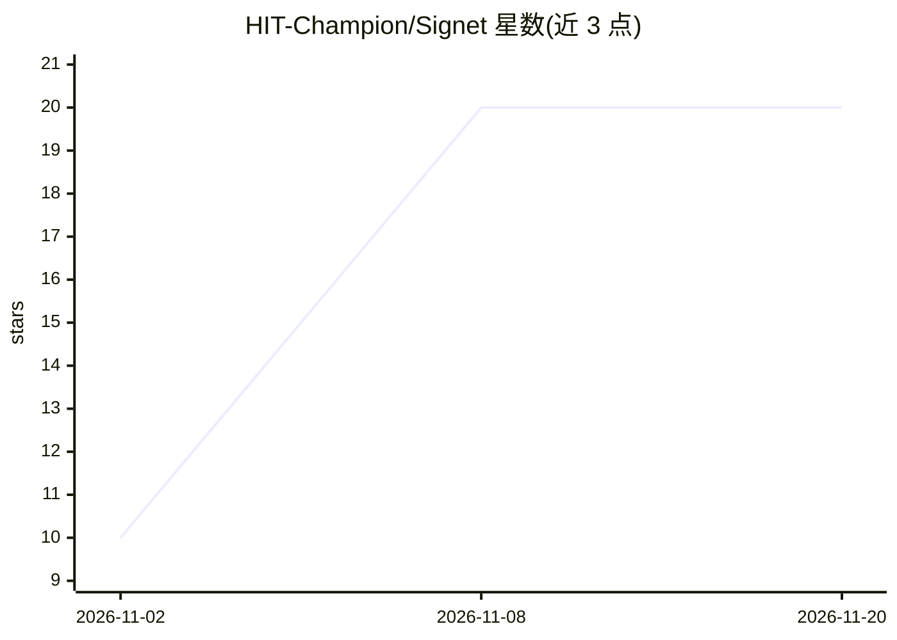

# HIT-Champion/Signet

⭐ 20 · Python · Apache-2.0 · 推送 2026-11-15 · [GitHub](https://github.com/HIT-Champion/Signet) · [官网](https://signet.htechcs.com) · 组织维护

**自部署电子公文核心平台，含越南 NĐ 30/2020 电子办公室**

面向学校、院系及基层机关的自托管开源核心平台：以无界面的第 1 层核心（身份 Keycloak、网关 APISIX、审计链、ClamAV 检疫、OpenBao 密钥库等开源组件组装）提供四个"可信印章"，首个应用为按 Nghị định 30/2020/NĐ-CP 管理公文收发全生命周期的电子办公室，含 BPMN 流程、办文时限提醒、全文检索、单位间互联与公开验文门户。AI 为本地运行的四个建议型 agent（读来文 PDF/OCR 填表单、公文库问答、交办建议、PII 遮蔽），默认 Ollama/Qwen3 1.7B CPU 运行，可换 OpenAI API。一键 `moc app install` 插装第三方应用。数字签名为演示性质、无法律效力。

## 筛选速览

| 维度 | 判定 | 备注 |
|---|---|---|
| AI 角色 | `ai-enhanced` | 去掉 AI 部分产品仍成立 |
| 许可风险 | `permissive` | Apache-2.0 |
| 部署形态 | `self-host` | docker 或自建部署 |
| 模型依赖 | local-ok | 支持本地模型 |
| 硬件要求 | — | 无带数字的原话,不猜 |
| 安装摩擦 | `low` | 无编译、无系统依赖或容器化 |
| 成熟度 | — | 结构信号不足 |

## 能力要点

- 四层"可信印章"：SSO 身份、ClamAV 检疫、哈希链审计、QR/SHA-256 公开验文
- 公文按 NĐ 30/2020 走接收到归档全流程，BPMN 流转与超限提醒
- 四个本地 AI agent：来文读取填单、库内问答带出处、交办建议、PII 遮蔽，默认无需外网
- `moc app install` 一条命令插装应用，不改核心文件

## 适用场景

- 院系/基层机关按 NĐ 30/2020 电子化管理公文收发与督办
- 把登录、文件、权限、审批等公共能力收敛到一个自托管核心，多应用插装
- 数据不出内网的前提下使用本地模型辅助登记、问答与交办

## 场景标签

`文档问答` `文档解析` · 领域:知识与检索

## 证据(README 行号)

> L38: Signet tách phần dùng chung đó thành một **lõi chạy ngầm, không giao diện**, lắp hoàn toàn từ phần mềm nguồn mở để 
> L129: AI trong Signet chỉ **gợi ý**, người quyết định; mặc định mọi thứ chạy trên máy chủ của tổ chức, dữ liệu không ra 

## 星数曲线

2026-11-02 10 → 2026-11-20 20（+10）

---
*卡片 v1 · prompt 1.4 · 生成 2026-11-18 · 置信度 mid · 依据 README sha `e527134f1fbe` · [字段定义](../../DATASET.md)*
