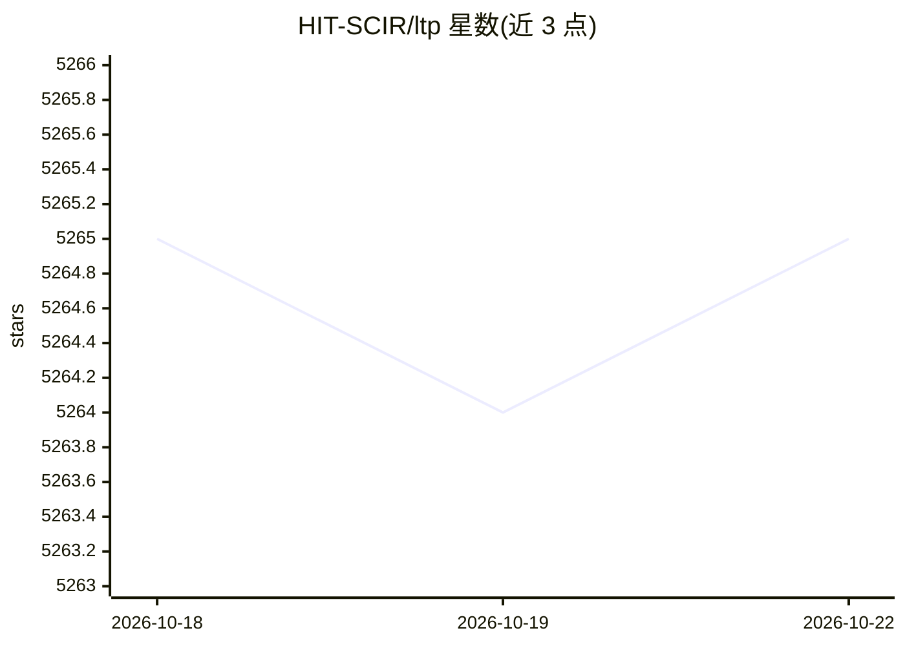

# HIT-SCIR/ltp

⭐ 5,264 · Python · 推送 2026-03-11 · [GitHub](https://github.com/HIT-SCIR/ltp) · [官网](http://ltp.ai) · 组织维护 · 中文 README

**面向中文 NLP 的开源工具平台：分词、词性、句法等六大任务**

哈工大社会计算与信息检索研究中心（HIT-SCIR）维护的中文自然语言处理平台，提供分词、词性标注、命名实体识别、语义角色标注、依存句法分析、语义依存分析六大任务。包含两类模型：基于 PyTorch 的深度学习模型（支持全部六任务，模型托管于 HuggingFace Hub 并支持自动下载）与 Rust 重写的感知机 Legacy 模型（仅分词/词性/命名实体，多线程下速度较高）。提供 Python 与 Rust 接口及 C/C++/Java 绑定，附带训练脚本与样例。许可对高校与个人免费，商业用途需付费。

## 筛选速览

| 维度 | 判定 | 备注 |
|---|---|---|
| AI 角色 | `ai-native` | 本体是模型或模型工具 |
| 许可风险 | `none` | — |
| 部署形态 | `library` | 以包/库形式分发 |
| 模型依赖 | — | README 未给出锁定关系 |
| 硬件要求 | — | 无带数字的原话,不猜 |
| 安装摩擦 | `low` | 无编译、无系统依赖或容器化 |
| 成熟度 | — | 结构信号不足 |

## 能力要点

- 深度学习模型支持中文六大 NLP 任务
- Rust 重写的感知机 Legacy 模型（16 线程下约 21581 句/秒）
- 模型托管 HuggingFace Hub，支持自动下载与用户自训练模型上传
- 提供训练脚本与 hydra 配置，支持私有数据训练

## 适用场景

- 对中文文本做分词、词性标注与句法分析
- 用自有数据训练个性化的中文 NLP 模型
- 在 Rust/C++/Java 项目中集成感知机中文分词能力

## 场景标签

 · 领域:中文自然语言处理

## 证据(README 行号)

> L12: LTP（Language Technology Platform） 提供了一系列中文自然语言处理工具，用户可以使用这些工具对于中文文本进行分词、词性标注、句法分析等等工作。
> L34:  - \[深度学习模型\] 即基于 PyTorch 实现的深度学习模型，支持全部的 6 大任务（分词/词性/命名实体/语义角色/依存句法/语义依存）

## 星数曲线

2026-10-18 5,265 → 2026-10-22 5,265（+0）

---
*卡片 v1 · prompt 1.4 · 生成 2026-10-20 · 置信度 high · 依据 README sha `5c6bdfe061f5` · [字段定义](../../DATASET.md)*
