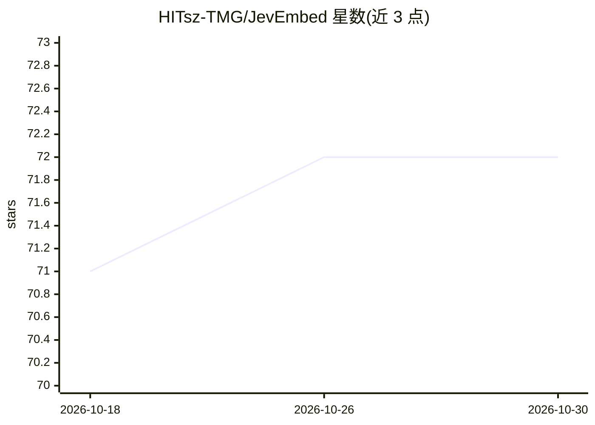

# HITsz-TMG/JevEmbed

⭐ 72 · Python · Apache-2.0 · 推送 2026-10-12 · [GitHub](https://github.com/HITsz-TMG/JevEmbed) · [官网](https://github.com/HITsz-TMG/JevEmbed) · 组织维护

**嵌入模型决策工具包：训练、推理与评测 Choice/Score/Noul 决策**

面向嵌入模型的决策工具链：将 KaLM、Qwen3-Embedding、E5、CLM 等嵌入模型用于 Choice、Score、Noul 三类结构化决策，覆盖监督数据合成（OpenAI 兼容模型生成）、LoRA 微调（含 soft targets 与合并权重）、本地推理与 HTTP 服务（/v1/systemone）、版本化 JSONL 基准评测（results.json/summary.json）及浏览器交互 Playground。提供 Python 3.10–3.12 环境的 pip 源码安装与多种 extras，发布 JevEmbed-Data（约 167 万标注问题）及三个微调模型。

## 筛选速览

| 维度 | 判定 | 备注 |
|---|---|---|
| AI 角色 | `ai-native` | 本体是模型或模型工具 |
| 许可风险 | `permissive` | Apache-2.0 |
| 部署形态 | `library` | 以包/库形式分发 |
| 模型依赖 | — | README 未给出锁定关系 |
| 硬件要求 | — | 无带数字的原话,不猜 |
| 安装摩擦 | `low` | 无编译、无系统依赖或容器化 |
| 成熟度 | — | 结构信号不足 |

## 能力要点

- 支持 9 个嵌入模型配置，含 3 个基于 JevEmbed-Data 微调的发布模型
- Choice/Score/Noul 三类决策的合成、微调、推理、评测一体化
- HTTP 服务模式（--serve）与浏览器交互 Playground（模型对比、Game Lab）
- 1.67M 标注训练数据集 JevEmbed-Data 公开在 Hugging Face

## 适用场景

- 用嵌入模型做选择题、打分与结构化决策输出
- 在自有数据上 LoRA 微调嵌入模型并合并权重
- 对多个嵌入模型跑统一 JSONL 基准并生成对比报告

## 场景标签

`模型评测` `微调` · 领域:评测与运维

## 证据(README 行号)

> L21: **One-Stop Decision Toolkit for Embedding Models: data synthesis, fine-tuning, inference, benchmarking, and interac
> L139: See official examples and scoring for Choice, Score, and Noul requests, saved Jev reference outputs, KaLM-embeddin

## 星数曲线

2026-10-18 71 → 2026-10-30 72（+1）

---
*卡片 v1 · prompt 1.4 · 生成 2026-10-24 · 置信度 high · 依据 README sha `a196132cd5d6` · [字段定义](../../DATASET.md)*
