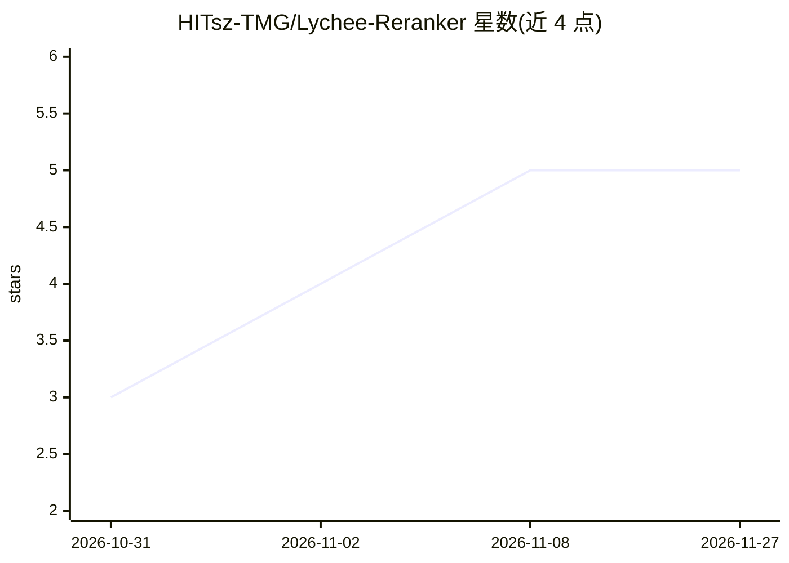

# HITsz-TMG/Lychee-Reranker

⭐ 5 · Python · MIT · 推送 2026-10-16 · [GitHub](https://github.com/HITsz-TMG/Lychee-Reranker) · [官网](https://huggingface.co/collections/KaLM-Embedding/lychee-kalm-reranker-and-jev) · 组织维护

**面向 RAG 的压缩文档重排模型的训练、推理与评测代码库**

Lychee-Reranker（前称 KaLM-Reranker-V1）的训练、推理与评测代码，支持 Nano/Small/Large 三档 T5Gemma2 编解码模型。推理时以 yes/no logits 的 P(yes) 为文档打分并排序，压缩比由 chunk_size 控制；训练流程为 SFT→双 KD 分支→LoRA 合并→等权 ModelSoup，提供 9 个配置配方；评测覆盖 BEIR 13 任务、MIRACL 18 语言与 LMEB 六组，主指标 nDCG@10。论文实验使用 32 GPU，README 另给单 GPU 可复现路径；模型权重与数据集单独提供。

## 筛选速览

| 维度 | 判定 | 备注 |
|---|---|---|
| AI 角色 | `ai-native` | 本体是模型或模型工具 |
| 许可风险 | `permissive` | MIT |
| 部署形态 | `library` | 以包/库形式分发 |
| 模型依赖 | — | README 未给出锁定关系 |
| 硬件要求 | — | 无带数字的原话,不猜 |
| 安装摩擦 | `medium` | 含编译或系统依赖之一 |
| 成熟度 | — | 结构信号不足 |

## 能力要点

- 提供 rank(query, documents, top_k) 推理接口，分数为 yes/no logits 的 P(yes)
- 完整训练流程：SFT、教师分数蒸馏、LoRA 合并、ModelSoup，含 9 个配方
- BEIR/MIRACL/LMEB 三套基准评测，主指标 nDCG@10
- faiss extra 可选加速大语料精确检索，无 faiss 时可用 NumPy 后端

## 适用场景

- 为检索增强生成（RAG）流水线加入文档重排环节
- 复现论文中的压缩重排训练与基准评测实验
- 基于自有 JSON/JSONL/Parquet 数据做 SFT 与蒸馏训练

## 场景标签

`RAG` `微调` `模型评测` · 领域:评测与运维

## 证据(README 行号)

> L16: Training, inference and evaluation code for
> L49: Scores are `P(yes)` from the `yes`/`no` logits, in input order. `rank(query,

## 星数曲线

2026-10-31 3 → 2026-11-27 5（+2）

---
*卡片 v1 · prompt 1.4 · 生成 2026-11-21 · 置信度 high · 依据 README sha `a82cf8ddb9c0` · [字段定义](../../DATASET.md)*
