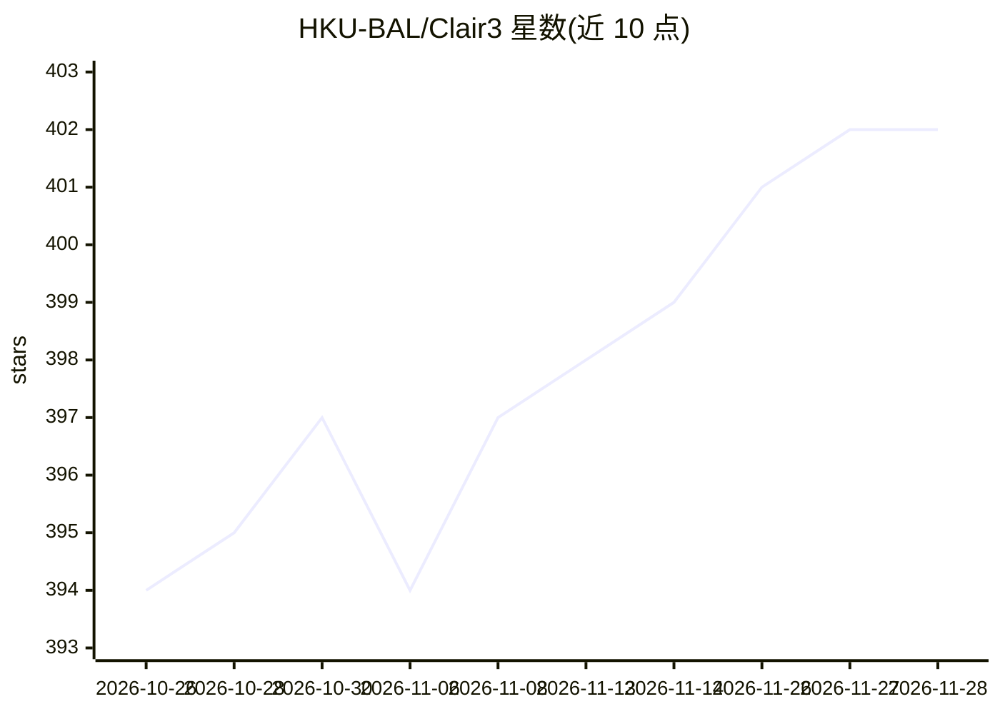

# HKU-BAL/Clair3

⭐ 402 · Python · 推送 2026-11-26 · [GitHub](https://github.com/HKU-BAL/Clair3) · 组织维护

**长读长测序胚系变异检测工具：深度学习检出 SNV/indel**

面向长读长测序数据的胚系小变异检测工具，结合两种互补模型：pileup 模型快速处理多数候选变异，全比对模型解决不确定候选。后端自 v2.0.0 从 TensorFlow 迁移到 PyTorch，支持 ONT 与 PacBio 数据及多种预训练模型，提供 gVCF 输出与 GPU 加速路径。通过 bioconda、Docker 镜像及源码方式分发，需自行构建时 libclair3 需重新编译。

## 筛选速览

| 维度 | 判定 | 备注 |
|---|---|---|
| AI 角色 | `ai-native` | 本体是模型或模型工具 |
| 许可风险 | `none` | — |
| 部署形态 | `self-host` | docker 或自建部署 |
| 模型依赖 | — | README 未给出锁定关系 |
| 硬件要求 | `cpu-ok` | |
| 安装摩擦 | `low` | 无编译、无系统依赖或容器化 |
| 成熟度 | — | 结构信号不足 |

## 能力要点

- pileup 与全比对双模型结合的变异检出
- 支持 ONT（含 move-table 信号感知模型）与 PacBio HiFi 数据
- NVIDIA CUDA 与 AMD ROCm GPU 支持，另提供 GPU Docker 镜像
- 输出 VCF/gVCF，捆绑预训练模型

## 适用场景

- 对 Nanopore 或 PacBio 长读长测序数据做胚系变异检测
- 使用 Dorado 带 mv 标签数据启用信号感知检出
- 为配套工具（Clair3-RNA/ClairS）选择合适的变异检出场景

## 场景标签

 · 领域:计算生物学/基因组学

## 证据(README 行号)

> L19: **Clair3** is a germline small-variant caller for long-read sequencing. It combines two complementary models to bal
> L87: - **PyTorch migration.** The deep-learning backend moved from TensorFlow to PyTorch. **v1 TensorFlow models are _no
> L94: Native GPU support on Linux (NVIDIA CUDA and AMD Instinct ROCm) and Apple Silicon. Clair3 on GPU runs **~5× faster 

## 星数曲线

2026-10-26 394 → 2026-11-28 402（+8）

---
*卡片 v1 · prompt 1.4 · 生成 2026-11-27 · 置信度 high · 依据 README sha `dac78343f3a0` · [字段定义](../../DATASET.md)*
