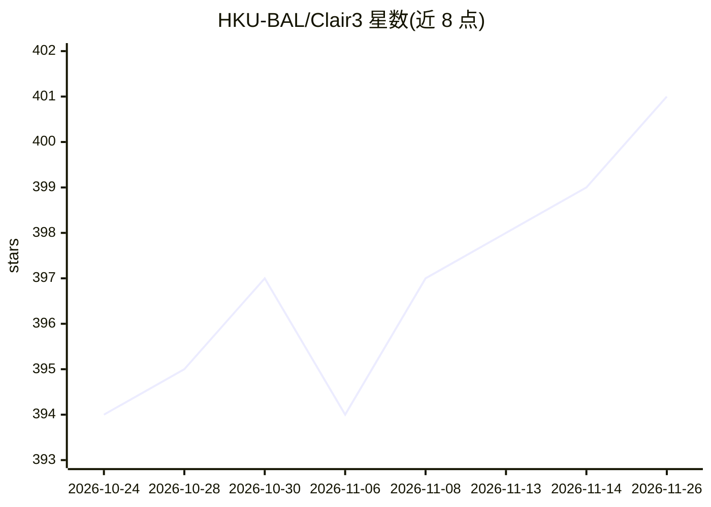

# HKU-BAL/Clair3

⭐ 401 · Python · 推送 2026-11-24 · [GitHub](https://github.com/HKU-BAL/Clair3) · 组织维护

**长读长测序的种系小变异深度学习检测工具**

Clair3 是面向长读长测序（ONT、PacBio）数据的种系小变异检测工具，结合两种互补模型：pileup 快速处理多数候选变异，全比对解析不确定候选。预训练模型随包捆绑，支持 BAM/CRAM 输入，输出 VCF/gVCF，支持单倍型定相与性别染色体 ploidy 处理。v2 起深度学习后端从 TensorFlow 迁移到 PyTorch，v1 模型与 v2 不兼容。提供 bioconda 与 Docker 安装，支持 NVIDIA CUDA 与 AMD ROCm GPU 及 Apple Silicon。

## 筛选速览

| 维度 | 判定 | 备注 |
|---|---|---|
| AI 角色 | `ai-native` | 本体是模型或模型工具 |
| 许可风险 | `none` | — |
| 部署形态 | `self-host` | docker 或自建部署 |
| 模型依赖 | — | README 未给出锁定关系 |
| 硬件要求 | — | 无带数字的原话,不猜 |
| 安装摩擦 | `low` | 无编译、无系统依赖或容器化 |
| 成熟度 | — | 结构信号不足 |

## 能力要点

- pileup + 全比对双模型组合的变异检测流程
- PyTorch 后端，预训练模型覆盖 ONT 多代化学试剂与 PacBio HiFi Revio
- Linux（CUDA/ROCm）与 Apple Silicon 原生 GPU 支持，另有 GPU Docker 镜像
- 支持 --enable_dwell_time 信号感知调用与 CRAM 3.1 输入

## 适用场景

- 对 ONT 或 PacBio 长读长数据做种系 SNP/indel 变异检测
- 用 pyTorch 预训练模型或自行训练的模型出 VCF/gVCF 结果
- 在 GPU 环境加速大批量样本的变异检测
- 通过 agentic AI 助手插件生成并运行 Clair3 命令

## 场景标签

 · 领域:生物信息学/基因组学

## 证据(README 行号)

> L19: **Clair3** is a germline small-variant caller for long-read sequencing. It combines two complementary models to bal
> L79: - **PyTorch migration.** The deep-learning backend moved from TensorFlow to PyTorch. **v1 TensorFlow models are _no
> L86: Native GPU support on Linux (NVIDIA CUDA and AMD Instinct ROCm) and Apple Silicon. Clair3 on GPU runs **~5× faster 

## 星数曲线

2026-10-24 394 → 2026-11-26 401（+7）

---
*卡片 v1 · prompt 1.4 · 生成 2026-11-25 · 置信度 mid · 依据 README sha `f88a2a7adbd7` · [字段定义](../../DATASET.md)*
