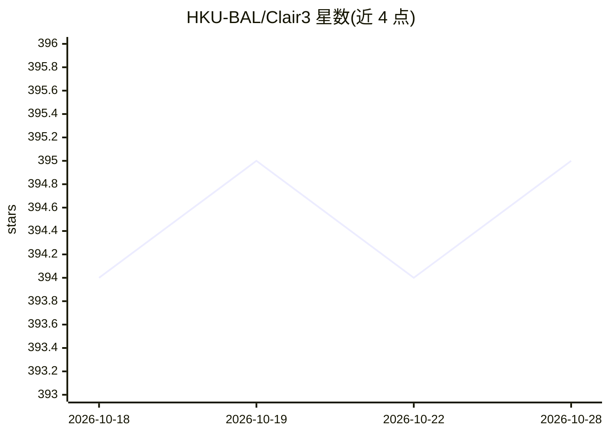

# HKU-BAL/Clair3

⭐ 395 · Python · 推送 2026-10-27 · [GitHub](https://github.com/HKU-BAL/Clair3) · 组织维护

**长读长测序胚系小变异检测工具（深度学习）**

港大 BAL 实验室维护的胚系小变异检测器，面向 ONT 与 PacBio 长读长测序数据，结合 pileup 与 full-alignment 两个互补深度学习模型：前者快速处理多数候选位点，后者基于单倍型解析的全比对处理不确定候选。v2.0 起后端迁移到 PyTorch（不兼容 v1 TensorFlow 模型），支持 ONT 信号感知检测（--enable_dwell_time）、GPU 加速与 Apple Silicon，提供 Docker/Singularity/Bioconda 等安装方式，另含面向 AI 编码助手的 Clair-skills 插件。

## 筛选速览

| 维度 | 判定 | 备注 |
|---|---|---|
| AI 角色 | `ai-native` | 本体是模型或模型工具 |
| 许可风险 | `none` | — |
| 部署形态 | `self-host` | docker 或自建部署 |
| 模型依赖 | — | README 未给出锁定关系 |
| 硬件要求 | — | 无带数字的原话,不猜 |
| 安装摩擦 | `low` | 无编译、无系统依赖或容器化 |
| 成熟度 | — | 结构信号不足 |

## 能力要点

- pileup + full-alignment 双模型架构的变异检测
- v2.0 迁移至 PyTorch，支持 ONT move-table 信号感知检测
- GPU 原生支持（Linux 与 Apple Silicon），提供 GPU Docker 镜像
- 覆盖 ONT/PacBio/Illumina 多平台的预训练模型

## 适用场景

- 对 ONT/PacBio 长读长测序数据做胚系 SNP/indel 检测
- 输出 VCF/GVCF 供下游基因组分析
- 使用自有数据重新训练或微调变异检测模型

## 场景标签

 · 领域:基因组学/生物信息

## 证据(README 行号)

> L19: **Clair3** is a germline small-variant caller for long-read sequencing. It combines two complementary models to bal
> L21: - **Pileup calling** — fast, handles the majority of variant candidates from summarized alignment statistics.
> L71: - **PyTorch migration.** The deep-learning backend moved from TensorFlow to PyTorch. **v1 TensorFlow models are _no

## 星数曲线

2026-10-18 394 → 2026-10-28 395（+1）

---
*卡片 v1 · prompt 1.4 · 生成 2026-10-21 · 置信度 high · 依据 README sha `2d71104a7cb9` · [字段定义](../../DATASET.md)*
