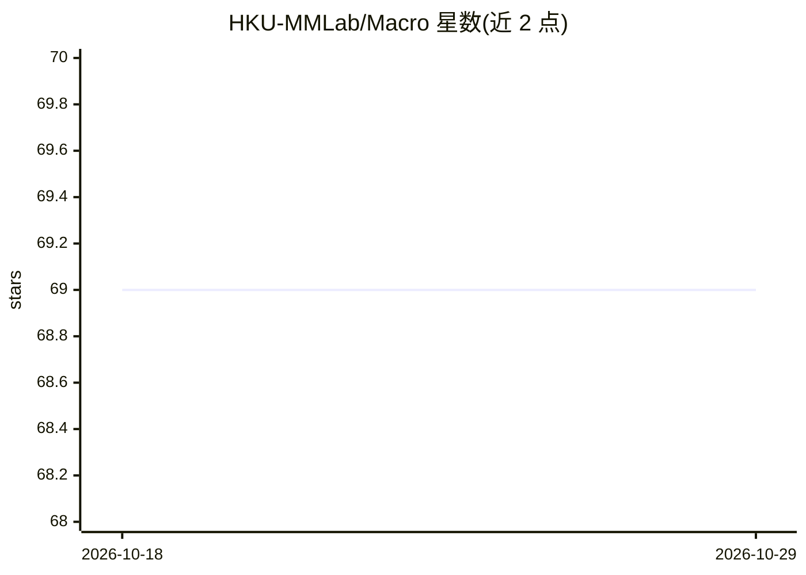

# HKU-MMLab/Macro

⭐ 69 · Python · 推送 2026-03-27 · [GitHub](https://github.com/HKU-MMLab/Macro) · [官网](https://macro400k.github.io/) · 组织维护

**多参考图生成的数据集与基准，附三个开源模型微调权重**

HKU MMLab 与美团合作发布的多参考图像生成数据集和基准 MACRO：覆盖定制化、插画、空间、时序四类任务，按参考图数量分 1–3/4–5/6–7/≥8 四档。同时提供在 Bagel、OmniGen2、Qwen-Image-Edit 三个开源模型上微调的检查点，配套单图推理脚本、批量推理、GPT/OpenAI 兼容接口的 LLM 打分流程，以及基于 config.yaml 生成训练脚本的两文件工作流。数据构建管线依赖内部集群与私有 API，仅作参考不可直接运行。

## 筛选速览

| 维度 | 判定 | 备注 |
|---|---|---|
| AI 角色 | `ai-knowledge` | 知识聚合/清单类 |
| 许可风险 | `none` | — |
| 部署形态 | `library` | 以包/库形式分发 |
| 模型依赖 | — | README 未给出锁定关系 |
| 硬件要求 | — | 无带数字的原话,不猜 |
| 安装摩擦 | `low` | 无编译、无系统依赖或容器化 |
| 成熟度 | — | 结构信号不足 |

## 能力要点

- 四任务类别 × 四参考图数量档位的数据集组织
- Bagel / OmniGen2 / Qwen-Image-Edit 三个微调检查点及推理脚本
- LLM 打分评测（GPT/OpenAI 兼容端点）
- 按参考图数量动态调整分辨率的批量推理

## 适用场景

- 下载基准评测多参考图像生成模型
- 用数据集微调自己的图像生成模型
- 用 LLM 打分流程对生成结果做自动评测

## 场景标签

`模型评测` `图像生成` `微调` · 领域:评测与运维

## 证据(README 行号)

> L15: **Macro** is a multi-reference image generation dataset and benchmark. It covers four task categories — **Customiza
> L233: > ⚠️ **This section is for reference only.** The pipeline depends on internal cluster infrastructure and proprieta

## 星数曲线

2026-10-18 69 → 2026-10-29 69（+0）

---
*卡片 v1 · prompt 1.4 · 生成 2026-10-24 · 置信度 mid · 依据 README sha `de28d5b2b588` · [字段定义](../../DATASET.md)*
