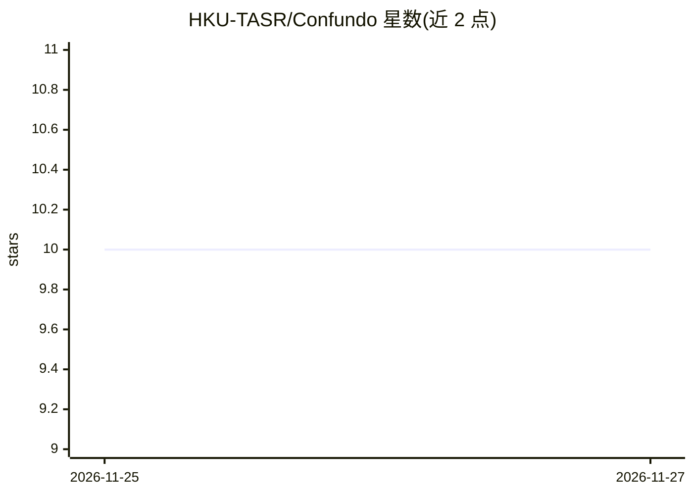

# HKU-TASR/Confundo

⭐ 10 · Python · MIT · 推送 2026-06-06 · [GitHub](https://github.com/HKU-TASR/Confundo) · 组织维护

**面向 RAG 系统的投毒攻击研究框架，微调 LLM 生成鲁棒毒文**

USENIX Security 2026 论文配套代码：微调大语言模型作为毒文生成器，向 RAG 知识源注入恶意内容，支持三类攻击目标——操纵事实正确性、诱导偏见观点、触发幻觉。提供交互式 notebook 演示、HuggingFace 微调模型（confundo-correctness/opinion/hallucination）、跨 RAG 框架（LlamaIndex/Haystack）迁移评估，以及对抗启发式过滤、LLM 意图检测、重排序、改写等防御机制的生存率评测脚本。训练需至少 48GB 显存的 GPU。

## 筛选速览

| 维度 | 判定 | 备注 |
|---|---|---|
| AI 角色 | `ai-native` | 本体是模型或模型工具 |
| 许可风险 | `permissive` | MIT |
| 部署形态 | `library` | 以包/库形式分发 |
| 模型依赖 | — | README 未给出锁定关系 |
| 硬件要求 | `gpu-24g` | |
| 安装摩擦 | `low` | 无编译、无系统依赖或容器化 |
| 成熟度 | — | 结构信号不足 |

## 能力要点

- 微调 LLM 作为毒文生成器，支持三类攻击目标
- 三个交互式 notebook 快速演示攻击流程
- 跨 RAG 框架迁移评估（LlamaIndex/Haystack 脚本）
- 含过滤、意图检测、重排序、改写四类防御评测

## 适用场景

- 评估自建 RAG 系统对内容投毒攻击的抵抗力
- 复现论文中各类防御机制下的毒文生存率实验
- 基于公开微调模型研究 RAG 安全威胁

## 场景标签

`模型评测` `RAG` `网络安全` `微调` · 领域:评测与运维

## 证据(README 行号)

> L1: # **Confundo: Learning to Generate Robust Poison for Practical RAG Systems**
> L28: Confundo provides a unified framework capable of supporting multiple adversarial objectives. We provide interactive
> L148: > 💡 **Note on Computation Time & Hardware:** A full training run typically requires a GPU with at least 48GB VRAM 

## 星数曲线

2026-11-25 10 → 2026-11-27 10（+0）

---
*卡片 v1 · prompt 1.4 · 生成 2026-11-25 · 置信度 high · 依据 README sha `d246e8cfad54` · [字段定义](../../DATASET.md)*
