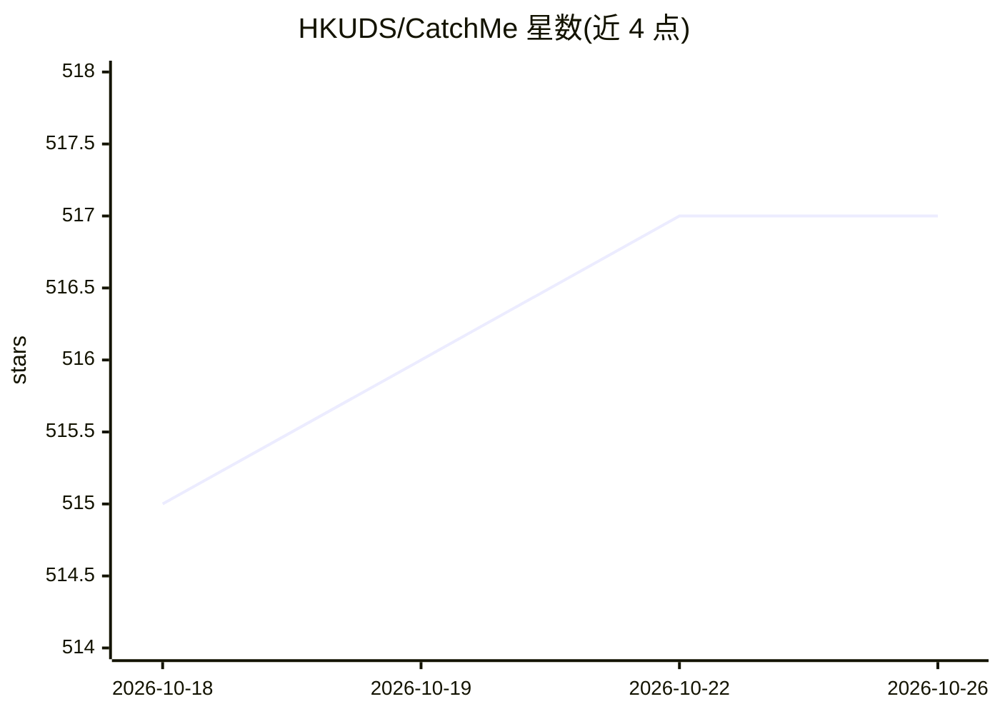

# HKUDS/CatchMe

⭐ 517 · Python · Apache-2.0 · 推送 2026-09-26 · [GitHub](https://github.com/HKUDS/CatchMe) · [官网](https://hkuds.github.io/CatchMe/) · 组织维护 · 中文 README

**本地记录全屏活动并构建可查询活动记忆树的工具，供 AI agent 调用**

CatchMe 通过六个后台录制器（窗口、键盘、鼠标、截图、剪贴板、通知）持续记录用户数字活动，原始事件自动组织为 Day→Session→App→Location→Action 五层活动树，每层由 LLM 生成摘要，检索时 LLM 自顶向下遍历树并读取截图等原始证据生成回答，不使用向量嵌入。数据全部本地存储（SQLite + FTS5，约 0.2GB 运行内存），支持 Ollama/vLLM/LM Studio 完全离线运行，也支持 OpenRouter/OpenAI/Anthropic 等云端 provider。以 CLI 工具提供（catchme awake/web/ask/mcp），可打包为技能文件接入 OpenClaw/Claude/Cursor 等 agent，或以 MCP server 暴露活动树。macOS 需授权辅助功能/输入监控/录屏，Linux 仅支持 X11 且未实现键盘捕获。由 HKUDS（香港大学数据智能实验室）维护。

## 筛选速览

| 维度 | 判定 | 备注 |
|---|---|---|
| AI 角色 | `ai-ecosystem` | LLM/agent 周边工具 |
| 许可风险 | `permissive` | Apache-2.0 |
| 部署形态 | `library` | 以包/库形式分发 |
| 模型依赖 | local-ok | 支持本地模型 |
| 硬件要求 | — | 无带数字的原话,不猜 |
| 安装摩擦 | `low` | 无编译、无系统依赖或容器化 |
| 成熟度 | — | 结构信号不足 |

## 能力要点

- 六个后台录制器持续捕获窗口/键盘/鼠标/截图/剪贴板/通知事件
- 五层活动树 + LLM 分层摘要，检索不走向量嵌入，LLM 遍历树定位证据
- 全量数据本地存储（SQLite + FTS5，约 0.2GB 运行内存），支持 Ollama/vLLM/LM Studio 离线运行
- 以技能文件接入 CLI agent，或经 MCP stdio server 向 Claude Desktop/Cursor 等暴露活动树

## 适用场景

- 让 AI agent 查询我今天的编码会话、浏览内容和文件改动
- 回放并检索自己一段时间的完整数字活动轨迹
- 在本地离线记录活动并做自然语言问答，数据不出机器

## 场景标签

`Agent 记忆` · 领域:Agent 开发

## 证据(README 行号)

> L30: **🦞 Makes Your Agents Truly Personal**. CatchMe ships as an agent-compatible skill for CLI agents (OpenClaw, NanoBo
> L82: - **One-File Setup**: Drop a single skill file into any AI agent for instant integration.
> L262: ## 🦞 CatchMe Makes Your Agents Truly Personal

## 星数曲线

2026-10-18 515 → 2026-10-26 517（+2）

---
*卡片 v1 · prompt 1.4 · 生成 2026-10-21 · 置信度 high · 依据 README sha `6a82e1d9036d` · [字段定义](../../DATASET.md)*
