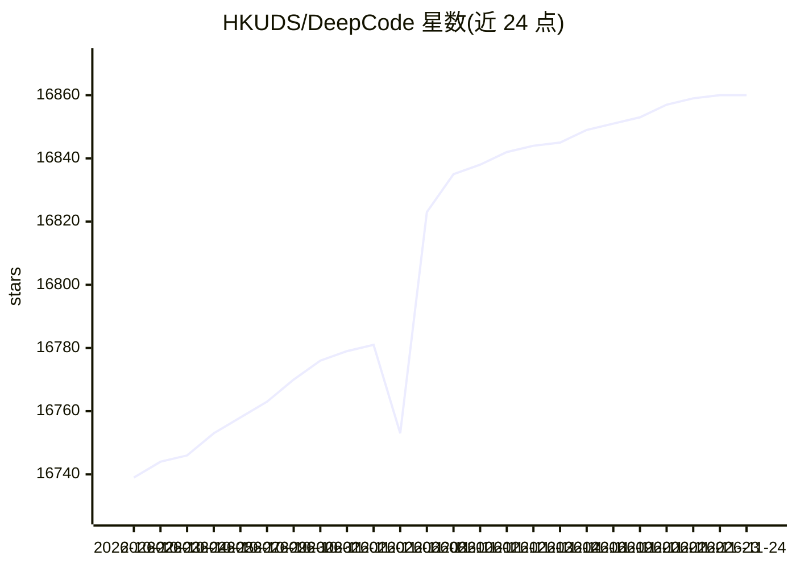

# HKUDS/DeepCode

⭐ 16,860 · Python · MIT · 推送 2026-11-22 · [GitHub](https://github.com/HKUDS/DeepCode) · [官网](http://arxiv.org/abs/2512.07921) · 组织维护 · 中文 README

**面向工程实战的开源编码 Agent，多客户端共享本地服务**

DeepCode 是一个开源编码 Agent：读取项目结构、编辑文件、运行命令与测试，以 Goal 形式执行长程任务。其机制包括完成度核验（运行用户确认的检查清单并可选独立评审）、压缩上下文保留原句、由本地后台服务持久化 Goal 与会话，支持中断/重启/切换模型后继续。提供 TUI、Desktop、Web 与 headless 四种客户端共享同一服务，支持 Ask/Read only/Full access 权限分级与 OS 沙箱；自我演化功能为规划中、尚未发布。安装需 Python 3.12+ 与支持工具调用的模型。

## 筛选速览

| 维度 | 判定 | 备注 |
|---|---|---|
| AI 角色 | `ai-ecosystem` | LLM/agent 周边工具 |
| 许可风险 | `permissive` | MIT |
| 部署形态 | `desktop` | 安装包/桌面程序 |
| 模型依赖 | local-ok | 支持本地模型 |
| 硬件要求 | — | 无带数字的原话,不猜 |
| 安装摩擦 | `low` | 无编译、无系统依赖或容器化 |
| 成熟度 | `idea` | |

## 动量与使用信号

- 维护:`active` — 距上次 push 3.8 天,年发版 12,33 位贡献者
- 涨星:近 1 天 **+9**(自 20261016 起算)
- 平台:— · 协议:OPENAI-API / MCP / OLLAMA

## 能力要点

- 完成度核验机制：运行确认清单并可选独立评审，不达标回退给 Agent
- 本地后台服务持久化 Goals、会话与审批，跨客户端续接
- 权限分级（Ask/Read only/Full access）与 shell 沙箱、编辑以 diff 展示
- 内置 14 个 provider 模板，支持自定义 OpenAI/Anthropic 兼容端点

## 适用场景

- 让 Agent 在真实仓库中完成多步骤修改并自动跑测试核验
- 在终端与浏览器之间续接同一个开发会话
- 接入自有模型端点或本地模型驱动编码任务

## 场景标签

`编码 Agent` · 领域:编码与开发

## 证据(README 行号)

> L76: DeepCode is an open-source Coding Agent for real software engineering. Give it
> L123: - **Any model.** Use any of 14 built-in providers, your own OpenAI- or
> L113: - **One session, four clients.** Turns run in a local background service,

## 星数曲线

2026-10-22 16,739 → 2026-11-24 16,860（+121）

---
*卡片 v1 · prompt 1.4 · 生成 2026-11-23 · 置信度 high · 依据 README sha `f4f9c2ddb7c9` · [字段定义](../../DATASET.md)*
