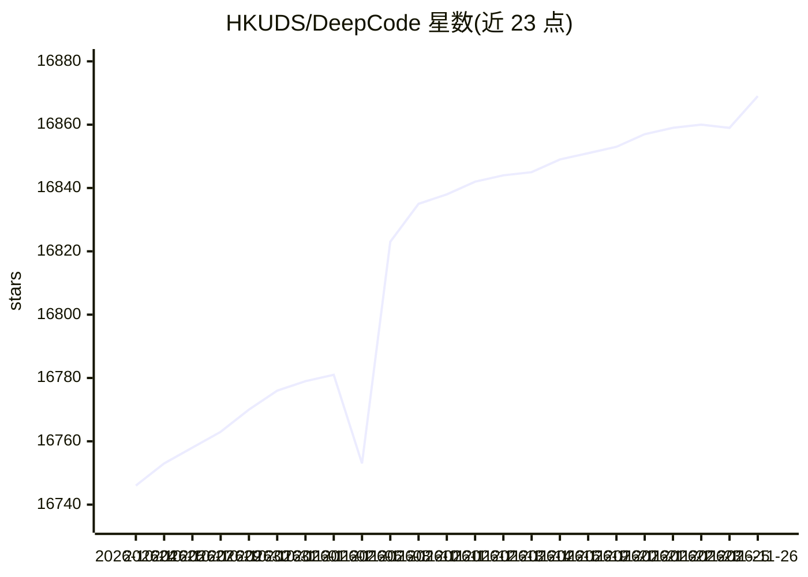

# HKUDS/DeepCode

⭐ 16,869 · Python · MIT · 推送 2026-11-23 · [GitHub](https://github.com/HKUDS/DeepCode) · [官网](http://arxiv.org/abs/2512.07921) · 组织维护 · 中文 README

**开源 Coding Agent：让开发者可靠完成真实工程任务**

面向真实软件工程的开源 Coding Agent：理解项目、编辑代码、运行命令与测试，并跨中断/重启/换模型继续任务。核心机制包括经检查清单与独立评审验证的完成判定、上下文压缩与自动停止的 Goal 管理、由本地后台服务保有的持久化状态。提供 TUI、Desktop、Web 与 headless 四类客户端，共享同一本地服务；权限分级、OS 沙箱与 diff 审查控制 agent 行为。需 Python 3.12+，模型须支持工具调用。

## 筛选速览

| 维度 | 判定 | 备注 |
|---|---|---|
| AI 角色 | `ai-ecosystem` | LLM/agent 周边工具 |
| 许可风险 | `permissive` | MIT |
| 部署形态 | `desktop` | 安装包/桌面程序 |
| 模型依赖 | local-ok | 支持本地模型 |
| 硬件要求 | — | 无带数字的原话,不猜 |
| 安装摩擦 | `low` | 无编译、无系统依赖或容器化 |
| 成熟度 | `idea` | |

## 动量与使用信号

- 维护:`active` — 距上次 push 3.8 天,年发版 12,33 位贡献者
- 涨星:近 1 天 **+9**(自 20261016 起算)
- 平台:— · 协议:OPENAI-API / MCP / OLLAMA

## 能力要点

- Verified completion：运行确认清单并由独立评审证明每条需求
- 四客户端共享本地服务，会话跨重启与模型切换延续
- 14 个内置 provider 模板与自定义 OpenAI/Anthropic 兼容端点
- MCP 客户端与服务端、Skills 插件体系、定时 Automations

## 适用场景

- 让 agent 在我的仓库里完成多步骤改动并通过测试验证
- 在终端、浏览器和桌面之间续接同一个编码会话
- 把论文或技术文档转成代码库（Paper2Code）
- 定时运行固定的指令自动化任务

## 场景标签

`编码 Agent` `代码生成` `工作流自动化` · 领域:效率与自动化

## 证据(README 行号)

> L68: DeepCode is an open-source Coding Agent for real software engineering. Give it
> L105: - **One session, four clients.** Turns run in a local background service,
> L29: DeepCode provides TUI, Desktop, and Web clients over one shared local service.

## 星数曲线

2026-10-24 16,746 → 2026-11-26 16,869（+123）

---
*卡片 v1 · prompt 1.4 · 生成 2026-11-24 · 置信度 high · 依据 README sha `e6d1a3d18058` · [字段定义](../../DATASET.md)*
