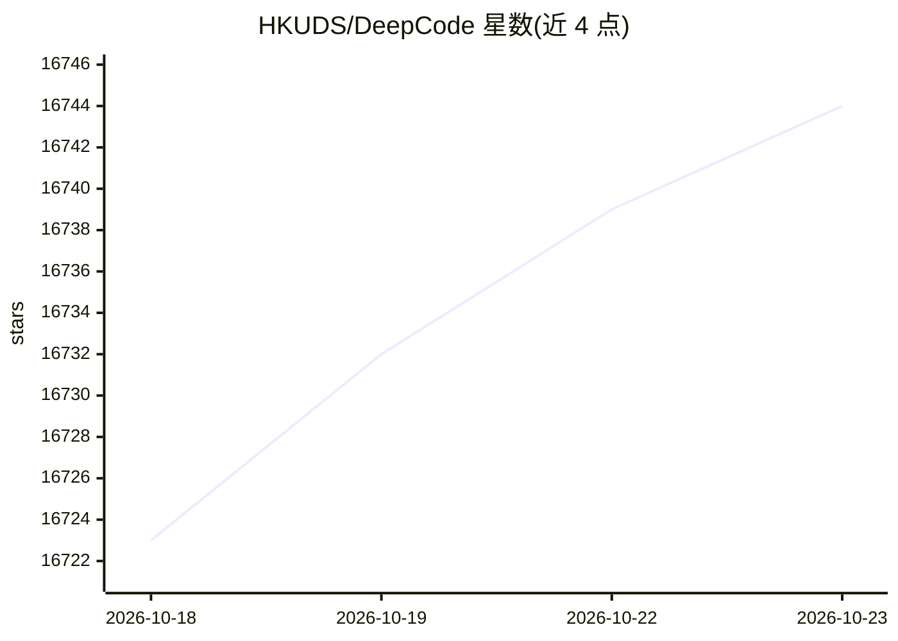

# HKUDS/DeepCode

⭐ 16,744 · Python · MIT · 推送 2026-10-22 · [GitHub](https://github.com/HKUDS/DeepCode) · [官网](http://arxiv.org/abs/2512.07921) · 组织维护 · 中文 README

**多客户端编程 Agent：把论文与自然语言转成代码**

HKUDS 出品的多 Agent 编程系统，围绕一个共享的本地后台服务提供 TUI、Desktop 与 Web 三种客户端，三者共享项目、会话历史、模型配置、Skills、权限与自动化。会话支持历史保留、上下文窗口上限与 /compact 压缩，后台服务自动迁移端口并支持跨客户端续接任务。安全机制包括命令沙箱、凭据隔离与可选的出站主机限制。支持语音听写、MCP 服务器管理与中文界面，Windows/macOS/Linux 均可运行。

## 筛选速览

| 维度 | 判定 | 备注 |
|---|---|---|
| AI 角色 | `ai-native` | 本体是模型或模型工具 |
| 许可风险 | `permissive` | MIT |
| 部署形态 | `None` |  |
| 模型依赖 | locked-api |  |
| 硬件要求 | — | 无带数字的原话,不猜 |
| 安装摩擦 | `low` | 无编译、无系统依赖或容器化 |
| 成熟度 | — | 结构信号不足 |

## 动量与使用信号

- 维护:`active` — 距上次 push 3.8 天,年发版 12,33 位贡献者
- 涨星:近 1 天 **+9**(自 20261016 起算)
- 平台:— · 协议:OPENAI-API / MCP / OLLAMA

## 能力要点

- TUI/Desktop/Web 三客户端共享同一本地服务与会话状态
- 命令沙箱隔离模型密钥与 SSH 私钥，可选出站主机限制
- 会话上下文窗口上限（/context）与 /compact 压缩机制
- MCP 服务器管理、语音听写、Paper2Code 功能

## 适用场景

- 从研究论文或自然语言描述生成可运行代码
- 在终端、桌面与浏览器间续接同一个编程任务
- 需要沙箱隔离与命令审查的本地 Agent 编码环境

## 场景标签

`编码 Agent` `多智能体` · 领域:Agent 开发

## 证据(README 行号)

> L41: DeepCode provides TUI, Desktop, and Web clients over one shared local service.
> L55: *🎯 **Watch our complete introduction** - See how DeepCode transforms research papers and natural language into prod
> L187: - **Choose your interface.** Run `deepcode` for the TUI, `deepcode desktop`

## 星数曲线

2026-10-18 16,723 → 2026-10-23 16,744（+21）

---
*卡片 v1 · prompt 1.4 · 生成 2026-10-18 · 置信度 mid · 依据 README sha `ab8f8da4edc4` · [字段定义](../../DATASET.md)*
