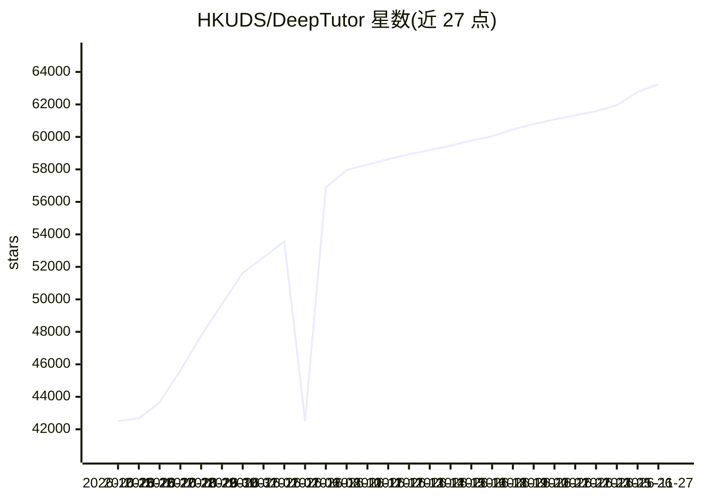

# HKUDS/DeepTutor

⭐ 63,246 · Python · Apache-2.0 · 推送 2026-11-26 · [GitHub](https://github.com/HKUDS/DeepTutor) · [官网](http://arxiv.org/abs/2604.26962) · 组织维护 · 中文 README

**面向学习者的终身个性化 AI 辅导平台（桌面版+CLI）**

HKUDS 开发的个性化辅导应用：围绕对话式 Tutor/Chat、知识库（RAG 检索、GraphRAG/LightRAG/PageIndex 等多种索引引擎）、Guided Learning 掌握度门控、Book/视频课程生成、Anki 与日历导出等功能组织学习工作区；支持多模态文档解析（MinerU、Tika、LiteParse）、15 个 IM 频道的 Partners、MCP 服务接入与社区技能安装（ClawHub）。提供 macOS/Windows 桌面安装包、Docker Compose、pip 与源码安装，文档站 deeptutor.info，附 arXiv 论文链接。

## 筛选速览

| 维度 | 判定 | 备注 |
|---|---|---|
| AI 角色 | `ai-native` | 本体是模型或模型工具 |
| 许可风险 | `permissive` | Apache-2.0 |
| 部署形态 | `desktop` | 安装包/桌面程序 |
| 模型依赖 | — | README 未给出锁定关系 |
| 硬件要求 | — | 无带数字的原话,不猜 |
| 安装摩擦 | `low` | 无编译、无系统依赖或容器化 |
| 成熟度 | — | 结构信号不足 |

## 动量与使用信号

- 维护:`active` — 距上次 push 0.7 天,年发版 86,200 位贡献者
- 涨星:近 1 天 **+83**(自 20261016 起算)
- 安装:npm 包 `to` 月下载 25,674
- 平台:— · 协议:OPENAI-API / MCP / OLLAMA

## 能力要点

- 知识库支持 GraphRAG/LightRAG/PageIndex/Obsidian 等多种检索引擎与 FAISS 向量后端
- Guided Learning 带按类型掌握度门控与 /learning 仪表盘
- Partners 可接入自有 persona/记忆，支持 15 个 IM 通道流式对话
- 多格式文档解析引擎可选（MinerU/Apache Tika/LiteParse/PyMuPDF4LLM）

## 适用场景

- 把我自己的 PDF/EPUB/YouTube 内容变成可问答的知识库并逐页引用学习
- 用掌握度门控的引导式学习路径刷题并沉淀错题/卡片
- 在微信、Telegram 等 IM 里通过 Partners 随时提问

## 场景标签

`文档问答` · 领域:知识与检索

## 证据(README 行号)

> L2:  DeepTutor: Lifelong Personalized Tutoring
> L9:  Docs — deeptutor.info
> L132: > **[2026.6.17]** v1.4.6 — Four-surface consolidation: a Space learning dashboard with importable **My Agents** an

## 星数曲线

2026-10-25 42,511 → 2026-11-27 63,246（+20,735）

---
*卡片 v1 · prompt 1.4 · 生成 2026-11-22 · 置信度 mid · 依据 README sha `84e78f6abf6c` · [字段定义](../../DATASET.md)*
