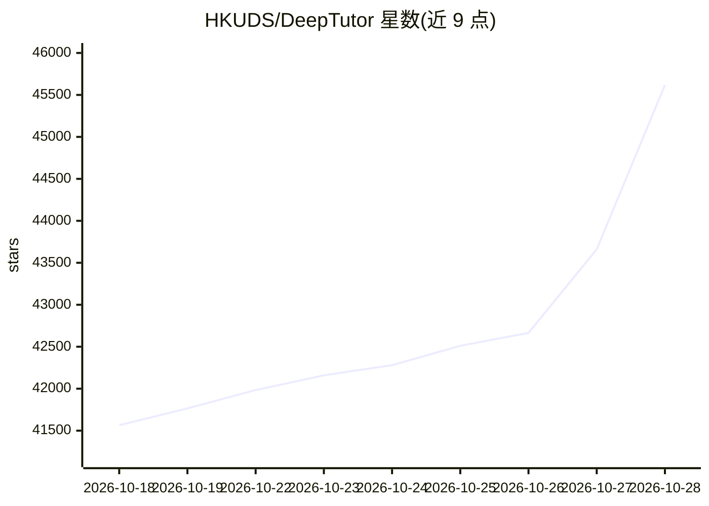

# HKUDS/DeepTutor

⭐ 47,766 · Python · Apache-2.0 · 推送 2026-10-28 · [GitHub](https://github.com/HKUDS/DeepTutor) · [官网](http://arxiv.org/abs/2604.26962) · 组织维护 · 中文 README

**面向学习者的终身个性化 AI 辅导应用（RAG+多智能体）**

DeepTutor 是一个自托管的个性化学习辅导系统：用户导入文档/书籍/视频构建知识库，通过聊天、引导式学习、深度研究、测验与掌握路径等功能获得 AI 辅导。机制上基于 LlamaIndex/LightRAG/GraphRAG/PageIndex 等检索引擎、三层记忆（L1/L2/L3）与单一智能体循环架构，支持多种云厂商 API 与本地运行时（如 Ollama、Lemonade），可接入本地 Claude Code/Codex，提供 CLI 工具、Docker 部署与多用户隔离部署。技术栈为 Python 3.11+ 与 Next.js 16，由 HKUDS 维护并附 arXiv 论文。

## 筛选速览

| 维度 | 判定 | 备注 |
|---|---|---|
| AI 角色 | `ai-native` | 本体是模型或模型工具 |
| 许可风险 | `permissive` | Apache-2.0 |
| 部署形态 | `self-host` | docker 或自建部署 |
| 模型依赖 | local-ok | 支持本地模型 |
| 硬件要求 | — | 无带数字的原话,不猜 |
| 安装摩擦 | `low` | 无编译、无系统依赖或容器化 |
| 成熟度 | — | 结构信号不足 |

## 动量与使用信号

- 维护:`active` — 距上次 push 0.7 天,年发版 86,200 位贡献者
- 涨星:近 1 天 **+83**(自 20261016 起算)
- 安装:npm 包 `to` 月下载 25,674
- 平台:— · 协议:OPENAI-API / MCP / OLLAMA

## 能力要点

- 知识库 RAG：LlamaIndex/LightRAG/GraphRAG/PageIndex 多检索引擎与引用溯源
- 三层记忆（L1/L2/L3）与单一智能体循环驱动的辅导/深度研究/测验能力
- 多渠道接入：多家云 API 提供商、Ollama 本地运行时、本地 Claude Code/Codex、MCP 工具
- 提供 CLI（deeptutor skill install / doctor / start）、Docker Compose 与多用户隔离部署

## 适用场景

- 把课程讲义、书籍、视频整理成知识库并长期提问学习
- 通过引导式学习路径与测验检验掌握程度
- 用深度研究模式对文档集合产出调研报告

## 场景标签

`RAG` `文档问答` `科研工具` · 领域:知识与检索

## 证据(README 行号)

> L3: # DeepTutor: Lifelong Personalized Tutoring
> L139: > **[2026.5.22]** v1.4.0 — GA cut of v1.4: Auto Mode, three-layer Memory, agentic Deep Research / Solve / Question
> L141: > **[2026.5.21]** v1.4.0-beta — Three-layer Memory workbench (L1/L2/L3), every chat capability rebuilt on a single

## 星数曲线

2026-10-18 41,565 → 2026-10-28 45,618（+4,053）

---
*卡片 v1 · prompt 1.4 · 生成 2026-10-20 · 置信度 low · 依据 README sha `5078b303835d` · [字段定义](../../DATASET.md)*
