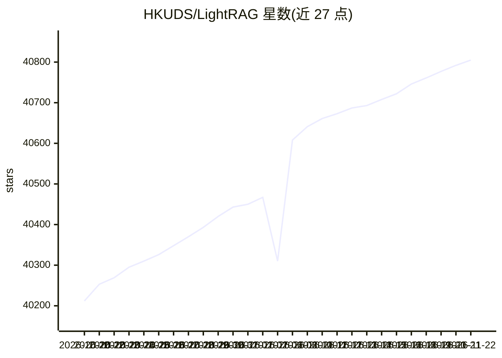

# HKUDS/LightRAG

⭐ 40,805 · Python · MIT · 推送 2026-11-21 · [GitHub](https://github.com/HKUDS/LightRAG) · [官网](https://arxiv.org/abs/2410.05779) · 组织维护

**给开发者的图结构 RAG 框架：文档入库、知识图谱检索与问答服务**

LightRAG 是一个检索增强生成（RAG）框架，提供基于知识图谱的索引与检索流程，并附带 API 服务器和预构建 WebUI 用于文档插入、查询与图谱可视化。支持多种文本分块策略、按角色独立的 LLM 配置、重排序、引用溯源与文档删除后图谱重建；通过 RAG-Anything 集成 MinerU/Docling 实现多模态文档解析。存储可用 PostgreSQL、Neo4j、MongoDB、OpenSearch 等后端，集成 RAGAS 评测与 Langfuse 追踪。通过 PyPI、源码或 Docker Compose 部署，需配置 LLM 与 embedding 的 API key。

## 筛选速览

| 维度 | 判定 | 备注 |
|---|---|---|
| AI 角色 | `ai-ecosystem` | LLM/agent 周边工具 |
| 许可风险 | `permissive` | MIT |
| 部署形态 | `self-host` | docker 或自建部署 |
| 模型依赖 | local-ok | 支持本地模型 |
| 硬件要求 | — | 无带数字的原话,不猜 |
| 安装摩擦 | `low` | 无编译、无系统依赖或容器化 |
| 成熟度 | — | 结构信号不足 |

## 动量与使用信号

- 维护:`active` — 距上次 push 2.6 天,年发版 28,315 位贡献者
- 涨星:近 1 天 **+21**(自 20261016 起算)
- 安装:pypi 包 `cairosvg` 月下载 13,091,552
- 平台:— · 协议:OPENAI-API / OLLAMA

## 能力要点

- 知识图谱索引与检索流程，支持 Fix/Recursive/Vector/Paragraph 分块策略
- EXTRACT/QUERY/KEYWORDS/VLM 四种角色的独立 LLM 配置
- WebUI 支持文档插入、查询与知识可视化，API 返回检索上下文
- PostgreSQL/Neo4j/MongoDB/OpenSearch 等统一存储后端与 Docker 部署

## 适用场景

- 把批量文档构建成知识图谱后做检索问答
- 需要引用溯源和多模态文档（PDF/Office/表格）解析的 RAG 应用
- 用 RAGAS 评测与 Langfuse 追踪来观测 RAG 系统质量

## 场景标签

`RAG` `知识图谱` `文档解析` · 领域:知识与检索

## 证据(README 行号)

> L3: # 🚀 LightRAG: Simple and Fast Retrieval-Augmented Generation
> L29: - [2024.11]🎯[New Feature] Introducing the LightRAG WebUI — an interface that allows you to insert, query, and visua
> L155: |`LLM_BINDING_API_KEY`|**Required.** Set your OpenAI API key|

## 星数曲线

2026-10-20 40,212 → 2026-11-22 40,805（+593）

---
*卡片 v1 · prompt 1.4 · 生成 2026-11-22 · 置信度 high · 依据 README sha `21c15446eba7` · [字段定义](../../DATASET.md)*
